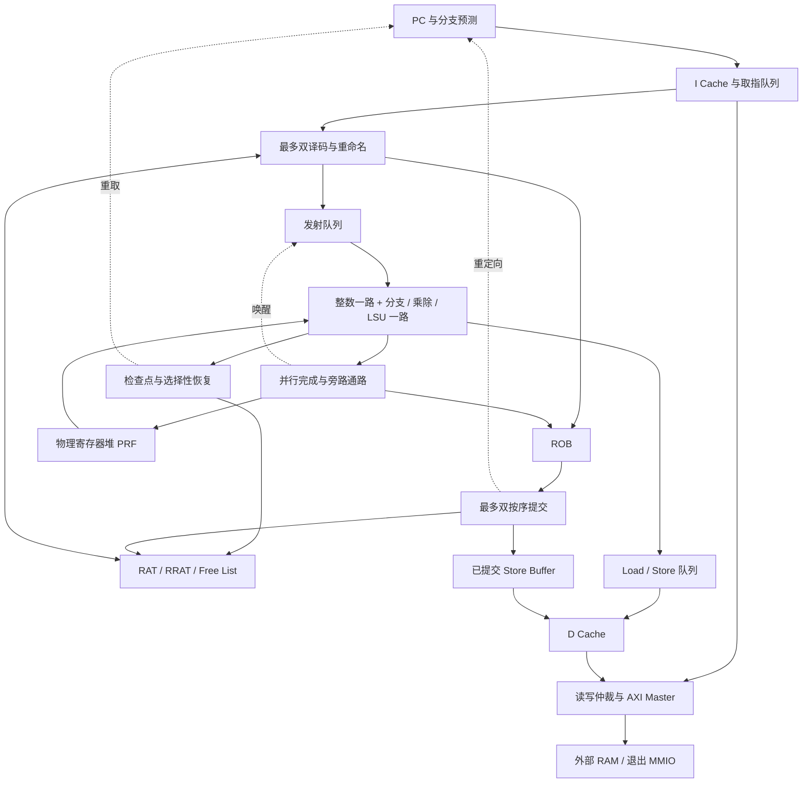

# SystemVerilog RV32IM 乱序 CPU 架构与实施规划

本文定义本课程 CPU 的整体架构、模块职责、接口约定、开发顺序和验收标准。采用 **PRF + ROB 的寄存器重命名架构**，先实现单发射、乱序执行、按序提交的正确性版本，再完善 Cache、分支预测和访存，最后扩展双发射。

主要目标为满足 95 分档要求，并保留冲击 100 分及频率加分的空间。文中的容量、宽度和组织方式是待验证的设计起点，不代表已实现或已达到对应性能。规划建立于 2026 年 10 月 13 日审阅的课程框架；测试分析对应子模块提交 `29f980727f7d99a1842a58f34091c7579ba3fe85`。

2026 年 10 月 19 日已实现 V6 非对称双发射乱序 CPU：成对取指、最多双重命名与双提交，整数通路可与访存、控制或乘除通路并行发射，并保留选择性提前恢复。同步上游前的默认配置 IPC 几何平均 **0.867648**、课程综合估算 **301.087915 MHz**、总面积 **17,205.338 μm²**，达到本版三个目标。同步官方 `302f0cf` 后，ABC 支持缓冲与尺寸优化配置；项目现采用上游示例的 **BUFx2 / 1 fF** 映射参数，同一 RTL 复测为 **608.437314 MHz、17,776.466 μm²**，IPC 不变，三项目标再次同时达到。OpenSTA 验收负载仍为 5 fF。当前测量与验收见 [V6 实施记录](experiments/v6.md)，历史对照保留在 [V5](experiments/v5.md)、[V4](experiments/v4.md)、[V3](experiments/v3.md)、[V2](experiments/v2.md) 与 [V1](experiments/v1.md)。下文的首版配置与开发阶段保留为设计演进记录；当前默认值以本节和顶层 RTL 为准。多缺失并行仍是后续规划。

### 当前 V6 实现边界

V7 的结构设计、参数筛选与实验原型另见 [V7 设计记录](experiments/v7-design.md)。该记录面向 IPC 几何平均高于 1.0985、频率高于 300 MHz、总面积不超过 36,000 μm²；生产 RTL 仍为下述 V6，原型以独立补丁提供。

| 路径 | 已实现结构 |
| --- | --- |
| 取指 | 8 个指令字的队列、最多 4 笔在途请求；对齐且首条预测顺序执行时取 2 字，否则取 1 字；按字预约容量，独立保存预测与取消身份；恢复后一拍起可请求新路径 |
| 预测 | 64 项完整 PC tag BTB、PC 异或索引；两位计数器与逐分支局部历史混合；按提交顺序训练；可选 RAS，默认关闭 |
| 后端 | ROB 16 / PRF 48 / IQ 6 / LSQ 8；最多双分配、双发射、双提交；第二分配/提交位置只接收普通整数指令，正确处理同组 RAW/WAW |
| 执行边界 | 两个独立的最老就绪选择器；普通整数专用一路，访存/分支/JAL/JALR/乘除另一路；IQ 保存成对年龄关系和执行载荷，选择/读数级寄存，完成支持唤醒与旁路 |
| 恢复 | 4 个 RAT 检查点；EX 检出误预测后下一拍恢复该分支映射，仅取消更年轻项；更老 Load、Store、乘除和 IQ 项保留 |
| 访存 | 8 项持久有序请求队列，发送与响应独立推进；空间足够时 Load 和提交的 RAM Store 可同拍入队；Load 保存最近旧写的逐字节转发快照，未知 Store 阻塞 Load |
| Store | RAM Store 在 ROB 头入队即退休；后续恢复不能取消；MMIO Store 仍等响应；连续 Store hit 可逐拍执行，Store→Load 保持必要的单端口隔离 |
| Cache | I Cache 2 KiB/直接映射/128 B 行，以 64 位同步 SRAM 读出两字；D Cache 16 KiB/4 路/256 B 行、写回/写分配；每个 Cache 最多处理一个缺失 |
| 命中延迟 | FIFO 为空时可直通同步 SRAM 查询结果，背压时保存；Load 请求可在预约持久上下文的同拍进入 Cache；仍只在完整填行且无错误后返回 Miss |
| 总线 | 16 笔读信用、16 笔写信用；AW/W 独立按序握手，B 回收；流水读 SRAM 写回，全部 B 完成后清脏 |
| MMIO | 等待所有更老队列响应；扫描所有组/路写回脏行，成功后才发送外部请求；8 条全清洁行可一拍跳过 |

检查点包含分支自身的目的映射，覆盖 JAL/JALR 链接寄存器及 `rd==rs1`，但不包含同拍第二条年轻指令的映射；恢复回收被取消目的寄存器，保留旧 PRF 就绪状态。ROB 按相对当前队首的年龄计算存活集合，重置队尾和计数；访存描述符不随 ROB 复用而丢失。恢复拍暂停响应消费，存活的 Load/乘除结果下一拍继续完成；被取消结果只排空，不写回。

PRF、ROB、IQ 与前端 FIFO 使用逐项写使能；空闲项允许预采样载荷，只有真实握手更新有效状态。提交读取采用旋转 one-hot 队首，发射载荷不经二进制索引再次读取 ROB。候选载荷与最终有效性分离，避免恢复信号穿过宽数据选择和唤醒路径。双译码释放的取指信用在下一拍重新使用，切断译码/分配到 Cache 请求的长组合路径；FIFO 两个队首使用旋转 one-hot 选择。参数与最终行长见 `verilog/student_top.sv` 和 V6 记录；取指、分配、发射、提交宽度支持 1/2，`ICACHE_WAYS` 仍只支持 1，写回模式的 `DCACHE_WAYS` 支持 1/2/4；旧写穿路径仅支持单路。RAS 非零或 I Cache 行长小于 8 B 时顶层自动回退单字取指。ROB、IQ、访存队列、检查点及前端支持非二次幂配置。

写回失败仍完整排空已发送请求、保留脏行和标签，不安装替换行、不发送后续 MMIO。Load 与串行 MMIO Store 保留原故障归属；已退休 RAM Store 的晚到错误使用持久队列中的原 PC/指令诊断并停止，不回滚已退休的年轻指令。这是异步错误契约，不是精确 Store 陷阱。当前范围不包括陷阱处理、自修改代码、缓存一致性和运行中复位保存脏数据。

## 1. 课程约束与设计范围

### 1.1 必须满足的要求

| 项目 | 要求 |
| --- | --- |
| 指令集 | RV32I 基础整数指令及完整 M 扩展 |
| M 扩展 | MUL、MULH、MULHSU、MULHU、DIV、DIVU、REM、REMU |
| 访存 | LB、LBU、LH、LHU、LW、SB、SH、SW；按指令宽度自然对齐 |
| 执行顺序 | 操作数就绪的年轻指令能够越过尚未就绪的老指令发射、执行 |
| 提交顺序 | 严格按照程序顺序退休 |
| 参数化 | 发射宽度、ROB 深度、PRF 数量、发射队列深度、Cache 容量与相联度 |
| 顶层 | `student_top`，端口严格遵循课程模板 |
| 外部接口 | 32 位 AXI4-Lite Master |
| 片上 SRAM | 通过框架提供的 `sram_fakeram` 实例化 |
| 报告 | 参数敏感度分析、架构探索与取舍，保留可解释的设计和实验记录 |

本项目不要求 CSR、FENCE、FENCE.I、ECALL、EBREAK，也不要求非对齐访存。首版范围不包含特权模式、虚拟内存、多核一致性和完整异常处理体系。遇到不支持的指令或访问错误时，应保留可诊断的故障信息，不能静默当作有效指令执行。

### 1.2 评分目标

| 档位 | 功能条件 | IPC 几何平均下限 | 总面积上限 | 最低频率 |
| --- | --- | ---: | ---: | ---: |
| 75 分 | 基础程序：向量乘法、向量加法、0 到 100 累加 | — | — | — |
| 85 分 | 继续通过其余正确性程序 | — | — | — |
| 90 分 | 正确性通过 | 0.6000 | 9,000 μm² | 300 MHz |
| 95 分 | 正确性通过 | 0.8450 | 18,000 μm² | 300 MHz |
| 100 分 | 正确性通过 | 1.0985 | 36,000 μm² | 300 MHz |

满足某一性能档位的全部条件后，400 MHz 加 2 分，500 MHz 加 4 分。面积包括标准单元逻辑和 SRAM 估算面积。频率以课程综合与时序分析结果为准，将目标周期设为 2 ns 本身不等于获得 500 MHz。

本地 IPC 使用测试的 `metrics.json` 中的动态指令数除以模拟器报告的周期数，六个性能点取几何平均。RTL 不需要为官方框架增加退休计数端口。线上评分配置独立维护，本文不推定其周期限额。

### 1.3 启动与内存约定

- `clock`、`reset` 都是 CPU 输入；复位高有效，框架启动时保持 5 周期。
- 复位 PC 取 `0x00000000`。已审阅的官方程序均从这里启动，由软件设置 `sp = 0x00040000` 并完成 BSS 初始化，硬件不硬编码程序专用状态。
- 外部 RAM 为小端 256 MiB，地址范围 `0x00000000`～`0x0fffffff`，镜像未初始化的外存字节为零。
- 向 `0x80000000` 进行完整字写，`WSTRB = 4'hf`，`WDATA` 为退出结果。
- 模拟器在该退出写的 **B 通道握手** 时结束。退出写必须按序成为不可撤销操作，并在更老 Store 完成后发送。
- 外存清零不代表片上 SRAM 清零；两者必须分别处理。

## 2. 总体微架构

### 2.1 数据流



从 V4 起，图中的 Load 请求队列与已提交 Store Buffer 合并为一个有序描述符队列，保证已入队 Store 的本地更新先于后续 Load。ROB 在重命名时分配，在写回时标记完成，在提交时按序释放。

### 2.2 首版与增强版配置（历史设计起点）

| 参数或结构 | 首版起点 | 增强方向 |
| --- | --- | --- |
| `FETCH_WIDTH` | 1 | 2 |
| `RENAME_WIDTH` | 1 | 2 |
| `ISSUE_WIDTH` | 1 | 2 |
| `COMMIT_WIDTH` | 1 | 2 |
| `ROB_DEPTH` | 16 | 32，比较 64 |
| `PRF_SIZE` | 48 | 64，比较 96 |
| `IQ_DEPTH` | 8 | 16，比较 24 |
| `LSQ_DEPTH` | 8 | 16 |
| 整数执行资源 | 1 个 ALU，分支可共享运算资源 | 增加可并行整数执行资源 |
| 乘除法 | 迭代实现，忙时不阻塞其他执行单元 | 按测量结果决定是否流水化乘法 |
| `ICACHE_BYTES` | 2 KiB | 2～4 KiB |
| `ICACHE_WAYS` | 1 | 优先维持 1，按缺失统计比较 2 |
| `DCACHE_BYTES` | 2 KiB | 优先比较 4 KiB |
| `DCACHE_WAYS` | 1 | 优先比较 2，必要时比较 4 |
| `CACHE_LINE_BYTES` | 16 B | 比较 32 B |
| 分支预测 | 顺序取指，之后加入静态预测 | 小型 BTB、两位计数器 BHT，可选 RAS |
| 恢复 | 误预测分支到 ROB 头后统一恢复 | 执行阶段发现误预测后提前恢复 |
| Cache 缺失 | 每个 Cache 最多一个缺失，首版可串行填充 | 行内请求流水发送，再评估多缺失并行 |
| Store | ROB 头等待写响应 | 按序进入已提交 Store Buffer 后异步排空 |

单发射指每周期最多选出一条指令，不等于只能执行 ROB 头。只要独立年轻指令能够越过未就绪老指令，仍然是真正的乱序执行。

100 分档要求 IPC 大于 1，取指、重命名、执行、写回和提交都必须有足够的持续吞吐，不能只把 `ISSUE_WIDTH` 改成 2。

### 2.3 参数合法性

- 当前 `FETCH_WIDTH`、`RENAME_WIDTH`、`ISSUE_WIDTH`、`COMMIT_WIDTH` 支持 1/2，默认均为 2；非对称双发射不支持同拍两条普通整数或两条访存，也不承诺任意宽度。
- PRF 至少容纳 32 个初始架构映射，并有额外物理寄存器供重命名；物理寄存器不足时反压。
- `PRF_SIZE >= 32 + ROB_DEPTH` 可避免仅因全部 ROB 项写寄存器而提前耗尽 PRF，但不是正确性的必要条件。
- Cache 容量能被行大小和路数整除；首版限定行大小、组数、路数为合法的 2 的幂。
- `IQ_DEPTH = 24` 等非 2 的幂容量必须显式处理指针回绕，不能只依赖位宽截断。
- 索引位宽使用至少 1 位；所有索引、计数与比较显式定宽。
- 参数以统一配置源和模块参数传递；现有 Make 接口没有提供通用 RTL 参数覆盖选项，实验时应记录实际使用的配置源。

## 3. 模块边界与工程组织

以下为建议的实现组织，目录中的 RTL 和验证文件按开发阶段创建。公共类型的具体表达形式以课程 Yosys 兼容性验证结果为准。

```text
verilog/
├── filelist.f
├── student_top.sv
├── cpu_core.sv
├── common/
│   ├── cpu_config.sv
│   ├── cpu_types.sv
│   └── fifo.sv
├── frontend/
│   ├── fetch.sv
│   ├── fetch_queue.sv
│   ├── decoder.sv
│   └── branch_predictor.sv
├── backend/
│   ├── rename.sv
│   ├── free_list.sv
│   ├── prf.sv
│   ├── rob.sv
│   ├── issue_queue.sv
│   ├── writeback.sv
│   └── commit.sv
├── execute/
│   ├── alu.sv
│   ├── branch_unit.sv
│   ├── mul_unit.sv
│   └── div_unit.sv
├── memory/
│   ├── lsu.sv
│   ├── lsq.sv
│   ├── store_buffer.sv
│   ├── icache.sv
│   └── dcache.sv
└── bus/
    ├── memory_arbiter.sv
    └── axi_lite_master.sv

verification/                   # 自建验证，与官方测试和脚本分开
├── unit/                       # 模块级测试
├── directed/                   # 指令与微架构定向程序
├── reference/                  # 功能参考模型与提交轨迹比对
└── runners/                    # 回归、参数扫描和结果整理

docs/
├── arch.md
└── experiments/                # 参数配置、测量结果和设计决策
```

`student_top` 保持课程外部端口，负责连接核心和总线。`cpu_core` 连接前后端及 Cache。验证能力通过内部仿真日志、断言或独立验证顶层接入，不改变官方顶层契约。

`filelist.f` 只列实际 `.v`、`.sv` 文件，路径相对该清单所在目录；配置与类型包必须早于使用者。不能把头文件、`+incdir+` 或其他编译选项作为条目。框架自动引入 `sram_fakeram`，不重复列出、不自定义同名空桩。

官方 `scripts/`、官方测试和构建规则作为评测依据；新增验证与实验工具放入独立目录。

## 4. 接口与全局状态规则

### 4.1 内部握手

流水模块默认使用 `valid/ready`，仅在 `valid && ready` 的时钟沿接收事务。发送者在被阻塞时保持载荷稳定，不能等待 `ready` 才生成 `valid`。

对于可被分支清空的内部流水项，接口应额外定义 `kill/flush`：清空可以取消尚未接收的推测项，且优先于其正常传输。这个例外不能应用到已经对外声明的 AXI `VALID`，也不能取消已经接受的 AXI 请求。

| 接口记录 | 必需信息 |
| --- | --- |
| 取指到译码 | PC、指令、预测下一 PC、有效性、取指故障标志 |
| 译码到重命名 | 操作类别、源／目标架构寄存器、源有效位、立即数、访存宽度与符号属性、预测信息 |
| 重命名到发射 | 指令标识、源物理寄存器、源就绪状态、目标物理寄存器、操作与立即数、PC |
| 发射到执行 | 指令标识、操作数值、操作类型、目标物理寄存器、分支／访存信息 |
| 执行到写回 | 指令标识、目标物理寄存器、结果、分支实际结果、完成／故障标志 |
| ROB 到提交 | PC、目标架构寄存器、`pdst`、`old_pdst`、完成状态、分支和 Store 信息 |
| 核心到 Cache | 请求标识、地址、读写属性、字节掩码、写数据；Store 的不可撤销授权 |
| Cache 到总线 | 对齐地址、请求来源、填充事务标识、行内字偏移、写数据与掩码 |

这是逻辑字段契约，不要求直接用复杂结构体数组表达。可以使用字段数组、打包向量和普通端口实现。

### 4.2 指令身份与迟到结果

ROB 索引在回绕或清空后会被复用，不能单独作为异步结果的身份。可采用 ROB 索引加分配代号，并检查当前条目的身份与目标寄存器；也可将原身份保留在不可提前复用的事务描述符中，以取消状态阻止迟到写回。当前实现使用后一种方式：访存描述符保留至响应排空，killed 状态不会因 ROB/PRF 复用而清除；乘除单元则显式取消年轻事务。单调递增的指令 ID 用于仿真轨迹核验，不是可综合恢复机制的前提。

有限位宽世代号不能假定永不回绕：必须保证旧事务尚未排空时不会复用相同身份，或阻止相关槽位复用。首版可对可取消执行单元显式取消，对不可取消外存事务保留失效的描述项直至收到响应。增强版提前恢复只杀年轻指令，不能用一次全局世代变化误杀仍存活的老指令。

读填充事务还需要自己的身份和目标行记录。取指指令的失效与 Cache 填充的生命周期分开：错误路径读可以丢弃，也可以按明确策略保留为合法的 Cache 填充，但不能覆盖已经复用的填充槽或唤醒失效指令。

### 4.3 必须保持的不变量

1. 架构寄存器 `x0` 永远读零；其物理映射固定，不分配、不释放、不写入。
2. 每个新物理目标只分配一次；每个待回收物理寄存器只释放一次。
3. 每条已接收指令在 ROB 中恰有一个身份，提交顺序与程序顺序一致。
4. 被清空指令不能写有效 PRF、更新已提交映射或产生 Store/MMIO 副作用。
5. Store 只有获得不可撤销授权后，才能更新 Cache 数据或发送外部写请求。
6. 队列计数保持在容量范围内；同周期入队、出队和清空只按一次统一规则更新。
7. 完成不等于提交；ALU、Load 和乘除可以提前完成，架构状态只在提交时确认。
8. 复位、恢复、正常提交／写回的同周期优先级必须在模块中明确。旧版提交后全清恢复使用更新后的 RRAT；V5 选择性恢复使用分支检查点，并保留仍未提交的更老状态，恢复拍暂停后端提交与完成。

## 5. 前端与分支

### 5.1 取指与译码

取指依次经过 PC 选择、I Cache 查询、响应缓冲、取指队列和译码。同步 SRAM 的查询及响应占用不同周期，必须携带对应 PC 与有效位。

译码覆盖课程要求的全部 RV32IM 指令，统一产生操作类型和立即数。特别验证 B/J 型立即数拼接、符号扩展、AUIPC 的 PC 基准、JAL/JALR 的返回地址，以及 JALR 清除目标地址最低位。

遇到尚未确认有效路径上的非法指令或取指错误时，保留故障标志到安全处理点，不能因为错误路径译码就提前终止正确程序。实际执行到的非课程支持操作，采用可定位的仿真失败策略；首版不实现完整陷阱向量体系。

### 5.2 分支预测与首版恢复

首版可以始终预测 `PC + 4`。分支单元计算实际下一 PC，并写入 ROB；预测错误的分支在成为 ROB 头时完成恢复：

1. 处理该分支本身的合法提交；JAL/JALR 的链接寄存器映射必须纳入提交状态。
2. 清空全部年轻 ROB、发射队列、LSQ 和前端指令。
3. 将 RAT 恢复为更新后的 RRAT。
4. 根据 RRAT 重建空闲物理寄存器集合，或使用等价且已验证的回收方式；恢复期间暂停重命名。
5. 取消或标记失效的执行结果与取指／Load 请求，保留必须排空的 AXI 描述项。
6. 从实际下一 PC 重新取指。已提交 Store Buffer 中的写入不属于年轻推测状态，不能被清空。

重建空闲列表期间要保证晚到结果无法污染即将重新分配的寄存器。可以用多周期恢复换取更简单的首版实现。

### 5.3 增强方向

先加入小型 BTB 与两位饱和计数器 BHT，按分支误预测统计调整容量；调用返回占比较高时再加入 RAS。首版预测器可在提交时更新，减少错误路径更新与恢复负担。

提前恢复时，必须保留误预测分支之前仍未提交的指令，使用检查点、逆序回滚或基于存活指令重建映射。不能恢复 RRAT 后直接继续执行这些老指令，因为它们的重命名状态尚未提交。V5 已采用 4 个 RAT 检查点实现此机制，检查点只在控制指令分配时生效，分支退休或被更老恢复取消时释放。

双宽取指可采用整行读取配合取指缓冲或分 bank。跨行取指允许拆成两次获取；遇到一组中较早的控制流指令，应按预测路径截断或重组后续槽位。

## 6. 重命名、发射、执行与提交

### 6.1 RAT、RRAT 与物理寄存器生命周期

- RAT：当前推测状态下，32 个架构寄存器到物理寄存器的映射。
- RRAT：最近已提交状态的映射，用于首版恢复。
- Free List：尚未被活跃状态占用的物理寄存器集合。
- PRF：物理寄存器值及就绪状态。

重命名读取旧 RAT 获得源寄存器；对于写入非零目标的指令，申请新 `pdst`，把原目标映射存为 `old_pdst`，将新目标标为未就绪，再更新 RAT。

当目标指令提交时，RRAT 更新到 `pdst`，释放 `old_pdst`。不能在写回时提前释放旧映射。复位时建立 32 个确定的初始映射，额外物理寄存器进入 Free List；用于验证的初始寄存器值策略应明确，不能依赖工具隐式初始化。

重命名只有在 ROB、目标发射队列、必要的 LSQ 和物理寄存器同时有空间时才能接受指令，避免部分分配后无法回滚。

双宽重命名按程序顺序处理两个槽位：第二条必须看到第一条当拍形成的源依赖和目标映射；两条写同一架构寄存器时，第二条的 `old_pdst` 是第一条新分配的寄存器。

多槽接口只接受程序顺序上的连续前缀，不能接收第二条而跳过第一条。首个双宽版本可以采用整组接受或整组停顿，之后再优化部分接受；未接受槽位的资源和映射不得生效。

### 6.2 发射与写回

首版从全部就绪且功能单元可接收的候选中选择最老指令，而不是只检查队头。环形 ROB 的年龄比较应以当前 head 的相对距离或等价顺序标识为依据，不能简单比较槽位编号。

PRF 首版使用寄存器实现，多读写端口及旁路必须计入面积。单个 1RW SRAM 不能直接满足多源读取和并发写回要求。

即使发射宽度为 1，变延迟执行单元也可能同拍完成。写回仲裁要么提供足够端口，要么让各执行单元保持完成结果直到被接收。PRF 更新、ROB 完成标记和依赖唤醒必须对应同一个被接受的结果。

新入队指令与写回同周期相遇时，不能漏掉唤醒；可使用旁路或合并后的就绪状态。双宽发射还需防止重复选择同一项，并按实际读端口、功能单元和写回带宽限制发射组合。

### 6.3 ALU 与乘除单元

ALU 覆盖加减、逻辑、移位和有／无符号比较。移位量仅取低 5 位，计算显式控制操作数位宽与符号属性。

乘除单元首版采用迭代实现，忙时其他执行单元继续工作。不得直接把未评估的组合除法器放入关键路径。

| 边界 | 必须满足的结果 |
| --- | --- |
| MULH / MULHSU / MULHU | 分别处理有符号、有符号乘无符号、无符号乘法高 32 位 |
| DIV / DIVU 除零 | 商为 `32'hffffffff` |
| REM / REMU 除零 | 余数为被除数 |
| `INT_MIN / -1` | 有符号商为 `INT_MIN`，余数为 0 |
| 有符号除法 | 商向零截断，非零余数与被除数同号 |

### 6.4 ROB 与提交

ROB 至少保存 PC、操作类别、架构目标、`pdst`、`old_pdst`、完成状态、分支结果、Store 关联和故障标志。普通无目标指令也需要 ROB 身份来维护顺序。

首版每拍最多提交一条完成且满足副作用条件的头部指令。双宽版本只提交从 head 开始连续满足条件的前缀，不得跨过未完成指令、待处理恢复或受阻 Store。

Store 的地址／数据准备完成和其写入完成是不同事件。首版在头部等待 Cache 本地更新或不分配处理完成，且收到成功 B 响应后退休；增强版在已提交 Store Buffer 接受责任后退休，由 Buffer 保证最终按序完成写入。

## 7. LSU 与存储顺序

### 7.1 首版策略

地址可以在操作数就绪后提前计算，外部访存先采用保守顺序。普通 Load 可以在确认更老 Store 已完成后执行；Store 只有到 ROB 头并满足提交条件后才能发出。

外存模型在服务时读取或修改数据，在之后返回响应。同周期读写的服务先后可能变化，因此 AW/AR 握手顺序不足以证明 Store-to-Load 顺序。没有转发机制时，等待更老 Store 的 B 响应是外存完成的安全边界；后续 Load 放行还必须确认该 Store 的 Cache 本地效果完成。

### 7.2 已提交 Store 缓冲与转发

RAM Store 到 ROB 头时，将地址、数据、字节掩码及独立身份放入 8 项访存队列，当拍退休。队列满则反压提交，分支恢复不能取消已提交条目。发送与响应使用独立指针，描述符只在响应消费时回收；已经退休的 Store 不再依赖 ROB 槽位内容。

D Cache 按序接收和完成请求。Store 命中响应最早在 SRAM 更新的同一边沿被接受，缺失先完成必要写回/填充，再更新并返回；队列收到成功响应后回收对应条目。此时数据可能仍为 Cache 中的脏数据，无需每个 Store 等待外存 B。所有 uncached/MMIO 先等待更老描述符响应，再由 Cache 完整清脏，故退出不能越过旧写或其错误。

未提交 Store 的地址和数据保存在 ROB。每个 Load 保存分配时更老 Store 的槽位掩码：

- 任一更老 Store 地址或数据尚未就绪，Load 等待。
- 对每个字节选择同字地址中最年轻的更老 Store，组合多个 SB/SH/SW 的数据。
- Load 捕获转发字节及掩码后仍访问 Cache；返回时以转发字节覆盖 Cache 数据，再做符号/零扩展。完全覆盖也走响应通路。
- 已退休 Store 已先进入有序队列，随后 Load 必须在其后访问 Cache，无需再搜索已回收的 ROB 项。
- Load 的执行入队与 ROB 头 Store 入队互斥，Load 优先；Store 同拍退休会从后续选择的掩码移除，而其队列次序已确定。

V5 恢复只标记比恢复分支年轻的未提交 Load 描述符为 killed，保留其发送/响应次序直到排空。错误路径读取可能填入缓存，但不能产生架构写回。当前仍禁止 Load 越过未知 Store，且 D Cache 缺失阻塞新接收；没有推测访存重放或多个 MSHR。

### 7.3 字节访问与 MMIO

总线地址统一为 `{addr[31:2], 2'b00}`，地址低位留给 LSU 处理字节选择。Load 提取目标字节／半字后执行符号或零扩展；Store 移位数据并生成对应 `WSTRB`。

`0x80000000` 退出写单独识别、绕过 Cache，不允许预取或推测写。退出前排空更老的已提交 Store，并等待退出写 B 响应。对该地址的读没有退出语义，框架会返回地址错误。

## 8. Cache、SRAM 与 AXI

### 8.1 Cache 首版

I/D 分离，容量、行大小和相联度参数化；先支持直接映射，再支持 2 路。D Cache 采用写穿、写不分配；I Cache 只读。尚无 FENCE.I 支持时，不将自修改代码作为本项目支持目标。

Cache 数据阵列使用 `sram_fakeram`。有效位用可复位状态管理；标签可以先用寄存器，后续视面积考虑 SRAM。同步读结果必须与延后一拍的请求信息对应。

V3 已落地四路写回/写分配与同步 SRAM 标签；V4 扩大为 16 KiB、128 B 行，并流水化命中及整行写回。V5 将 D 行长增至 256 B，I 行长保持 128 B，加入命中响应直通和连续 Store 标签查询。具体写回错误归属与 MMIO flush 契约见文首当前实现边界。这里的“首版”保留为历史设计起点。

每个 SRAM 实例是单端口 1RW，每拍只能读或写；写周期和禁用周期不能使用其 `rdata`。命中查询、Store 更新和 refill 写入应明确仲裁并产生反压。

从查询被接受到读结果被消费之间，需要固定其行身份和访问顺序。首版可锁定相关事务，禁止冲突的行替换或 Store 更新；后续如允许重叠，必须通过旁路或重放保证读到正确版本。仲裁同时应保证 refill 和已提交 Store 最终得到服务。

首版只有一个缺失上下文，整行填充完成后才能将整行设为有效。若后续实现关键字优先返回或按字有效位，需单独验证未填充字不会被错误命中。

### 8.2 总线与填充

AXI4-Lite 没有 burst，16 B 行需要四次 32 位读。首版可以逐字完成；增强版应连续发送行内多个请求以重叠外存延迟，而不是每收到一个字才请求下一个字。

共享 AR/R 通道由 I/D 仲裁器管理，首版可用公平轮转。每次实际 AR 握手时，按同一顺序记录响应描述项：请求来源、填充事务身份、目标行、行内字偏移等。R 握手时弹出对应队头。只有描述队列有空间才发出请求。

框架 AR、AW、W、R、B 各有 16 项队列，每拍最多开始服务一个读和一个写。CPU 自身的在途上限由可用描述空间决定，不假定从机永远 ready。默认 `LATENCY=10` 是服务到响应可见的参数，不是固定的地址握手到返回间隔；完成一律由握手判定。

AW 和 W 独立握手，分别保存是否已发送及稳定载荷。一个通道成功后不能重发；多笔写时两条通道各自保持相同的事务顺序。B 响应按写事务顺序关联。

分支恢复不能撤回已声明且尚未握手的 AXI `VALID`，也不能丢弃已接受事务的归属描述。对失效指令的返回继续接收并安全丢弃。`RRESP/BRESP` 非 OKAY 的处理应明确，不能把错误响应当成有效数据或成功退出。

Load 或取指的错误响应随关联指令记录故障，在其到 ROB 头确认属于有效执行路径时诊断失败；已失效路径的错误响应消费后丢弃，不能在 AXI 层遇到读错误就提前结束程序。Cache 不将出错填充标为有效。写穿 Store 的外部错误归属于当前 Store；V3 脏行写回失败保留完整脏行，并归属于触发写回的当前请求，不能追溯到已经退休的 Store。

### 8.3 面积与组织方式

当前框架 SRAM 估算面积为 `bit 数 × 0.0419904 μm²`。单个 4 KiB 数据阵列约 1,376 μm²，I/D 各 4 KiB 的数据阵列合计约 2,752 μm²，尚未包含标签、有效位和控制逻辑。

PRF 多端口、发射选择、广播唤醒、旁路、ROB 和恢复逻辑也可能占较大面积。每加入重要结构就综合一次，使用 `diagnose` 定位模块成本，以 `opt` 比较最终结果。

## 9. SystemVerilog 编码约定

- 使用 `logic`、`always_ff`、`always_comb`、静态数组和参数化模块作为基础。
- 时序逻辑使用非阻塞赋值；组合逻辑完整给默认值，禁止意外锁存器。
- 不依赖 `initial` 或声明初始化获得硬件复位状态；课程综合会拒绝残留初始化属性和锁存器。
- 操作数、常量、指针及符号转换显式定宽；处理好算术右移和高位乘法。
- 一个状态对象由一个清晰的时序过程拥有，统一处理同拍的分配、释放、写回和恢复。
- `package`、`enum`、打包结构体及其数组组合先通过小模块的 Verilator 与课程 Yosys 双重验证；必要时改为字段数组或打包向量。
- 不将 class、动态 queue、动态数组、DPI 或复杂 interface 作为可综合 CPU 的基础。
- 仿真日志和断言使用明确的调试开关及综合排除条件；正式评测关闭会污染标准输出的日志。
- 正式 RTL 清单与独立验证顶层分开。框架已经开启 Verilator 断言，但不代表所有测试平台语法都可综合。

## 10. 验证体系与验收标准

### 10.1 单元级验证

| 对象 | 重点 |
| --- | --- |
| 译码与 ALU | 每条必需指令、立即数边界、符号比较、移位量截断、x0 |
| 乘除 | 随机操作数、高位乘法符号组合、除零、最小负数溢出 |
| FIFO / ROB | 满空、同拍入出、回绕、非 2 的幂容量、清空 |
| 重命名 / PRF | RAW/WAR/WAW、连续同目标、资源耗尽、释放与恢复 |
| 发射 / 写回 | 老指令未就绪、年轻指令可执行、同拍完成仲裁、入队与唤醒相遇 |
| LSU | 所有字节 lane、半字偏移、扩展、重叠 Store、未知地址 Store |
| Cache | 冷缺失、冲突缺失、替换、写命中／缺失、填充与访问冲突 |
| AXI | AW/W 分离握手、长期背压、多笔在途、响应归属与错误响应 |

随机总线背压由自建验证环境提供，不修改官方模拟器来获得更有利的行为。

### 10.2 微架构定向程序

1. 老指令等待 Load，独立年轻 ALU 指令先发射、先完成，提交仍然按序。
2. 依赖链、多个指令连续写同一架构寄存器、读后写与写后读组合。
3. 分支误预测前后包含长延迟乘除、Load、普通 Store 和退出 MMIO。
4. 清空后 ROB／PRF 槽位复用，旧响应晚到；连续多次恢复不得造成身份混淆。
5. Store 后立即同址 Load、不同字节重叠、多个待写项与 Cache 填充竞争。
6. ROB、IQ、LSQ 和 Store Buffer 满时持续反压，资源释放后恢复推进。
7. JAL/JALR 链接寄存器写入与恢复同拍，双宽时还包括槽间依赖和同目标写入。

### 10.3 提交轨迹与参考模型

仿真调试记录至少包含提交序号、PC、指令、架构目标与结果；Store 记录有效地址、数据和字节掩码。与独立功能参考模型按退休顺序比较，在第一条差异处停止定位。

记录的是架构提交事件，不直接用乱序执行时间与顺序参考模型比较。错误路径的执行结果不能进入提交轨迹。Store 进入已提交 Buffer 后即由其承担副作用责任，参考模型按同一程序顺序解释 Store。

### 10.4 官方测试的覆盖与限额

固定版本共有 19 个 `correctness_*` 和 6 个 `perf_*`。六个性能测试的正确退出值均为 0；性能测试也必须先验证结果。

静态反汇编未覆盖的必需指令包括 `LB LH LHU SH SLT SLTI SLTIU SRA OR ORI AND MULH MULHSU MULHU DIVU`；其他指令也不能仅因出现在反汇编中就认定边界已覆盖。因此官方全通过只是程序回归门槛，不能替代完整 ISA 单元测试。

| 较长的正确性程序 | 动态指令数 |
| --- | ---: |
| correctness_pi | 3,117,658 |
| correctness_qsort | 1,097,111 |
| correctness_tak | 1,221,227 |

默认 `MAX_CYCLES=1000000` 不适合完整回归；本地功能回归先显式使用 `100000000`，尤其首版存在迭代除法。增加超时上限不降低实际周期数，也不提高 IPC；保留前进性检查，避免用放宽上限掩盖死锁。最终以确认后的线上限额验收。

## 11. 性能优化与实验记录

### 11.1 性能测试的关注点

| 测试 | 动态指令数 | 优先关注 |
| --- | ---: | --- |
| perf_median | 6,961 | 分支预测、Load-use 延迟 |
| perf_multiply | 21,722 | 移位加法依赖、分支 |
| perf_qsort | 139,900 | 分支、D Cache 冲突、递归访问 |
| perf_rsort | 195,719 | D Cache、访存吞吐 |
| perf_towers | 5,278 | 栈访存、转发、Store Buffer |
| perf_vvadd | 4,524 | 顺序访存、取指与执行吞吐 |

当前六个性能程序均没有 M 扩展指令，`perf_multiply` 是移位加法乘法。M 扩展正确性必须完整，但不能根据测试名称把流水乘法器列为性能优化首要任务。

排序程序存在相隔 8 KiB 的数组：`qsort` 的 `verify/input` 位于 `0x248/0x2248`；`rsort` 的 `verify/input/scratch` 位于 `0x3bc/0x23bc/0x43bc`。这些地址会在 2/4/8 KiB 的直接映射 D Cache 中映射到相同组。应比较相联度、容量和替换策略，不用针对某个测试地址的特殊规则绕过正常硬件行为。

### 11.2 优化顺序

1. 建立正确的 I/D Cache，流水发送一行填充请求，减少基本外存等待。
2. 根据误预测和前端空泡加入分支预测、提前恢复。
3. 加入已提交 Store Buffer、Load 转发和 D Cache 两路相联。
4. 扩展取指、重命名、发射、写回与提交的整体吞吐。
5. 根据面积报告和关键路径调整队列规模、读写端口、广播和旁路结构。

每一步都以实际停顿原因验证收益。V5 已实现 Store 缓冲、逐字节转发、命中流水、并行完成与检查点提前恢复；多缺失并行、推测越过未知 Store、复杂全局预测器等仍属于后续候选，只有瓶颈明确且验证时间充足时才加入。

### 11.3 统计与实验方法

内部调试计数器记录：提交指令与总周期、前端缺供、分支数与误预测数、I/D Cache 缺失、ROB/IQ/LSQ 满、PRF 耗尽、Load 等待、Store Buffer 满、发射空泡、执行资源与写回冲突。定义每个计数事件及分母；不同停顿可以重叠，不能未经处理就相加为总周期。

先单变量比较，再组合改进，最后对选定配置完整回归。建议比较：

- 发射及配套宽度：1 与 2。
- ROB：16、32、64；PRF：48、64、96，剔除不支持的组合。
- IQ：8、16、24；LSQ：8、16。
- I/D Cache 容量：2、4、8 KiB；相联度：1、2，必要时 4。
- 行大小：16、32 B；预测器：关闭、简单静态、小型动态。

每次记录代码提交、配置内容、测试子模块版本、工具版本、`LATENCY`、周期限额、各性能点周期与 IPC、几何平均、`opt` 面积与频率、关键路径、正确性结果。六项几何平均等权，不能只优化最长的程序。

实验报告至少包括：架构图、模块接口、寄存器生命周期、恢复与访存策略、覆盖说明、参数敏感度曲线、面积及关键路径分析、最终配置选择依据、局限和复现方法。保留设计决策和 AI 交互记录，确保成员能解释实现细节。

## 12. 开发环境与命令

### 12.1 环境路线

本机为 Apple Silicon Mac，采用原生仿真与 Linux 容器综合两条路径。安装状态、统一命令入口与实测记录见 [本地开发环境](local-environment.md)。实现 RTL 时遵循：

1. 初始化固定版本测试子模块；当前子模块 URL 使用 GitHub SSH，按实际访问方式配置。
2. Mac 可使用原生 Verilator 进行日常迭代，显式设置 `APPIMAGE=` 或工具路径。
3. 在 Linux 上使用课程 AppImage 或课程 Dockerfile 对齐正式工具链；Linux x86-64 AppImage 不直接用于 macOS。
4. 在正式环境同时验证 Verilator 编译与 Yosys 综合，尤其公共 SV 类型和存储组织。

机器专用路径留在本地配置中，最终提交不依赖个人机器的绝对路径。

### 12.2 回归与提交入口

以下命令在工具链就绪且已有对应 RTL 后执行；本架构规划本身不代表这些检查已通过。

```sh
git submodule update --init --recursive
make build
make test Case=correctness_add_to_100 MAX_CYCLES=100000000
make test MAX_CYCLES=100000000
make perf MAX_CYCLES=100000000 LATENCY=10
make synth MODE=diagnose
make synth MODE=opt
make
```

`diagnose` 用于定位模块面积，`opt` 用于最终配置比较，两种模式的结果不能混用。默认 `CLOCK_PERIOD_NS=2.0`，改变目标周期可能改变映射结果，实验必须记录。

`make` 会重新编译 RTL 并生成提交用 `code`；本地 `SIM` 设置不能替代这一步。正式验收在干净参考环境执行，检查完整文件清单、官方顶层、全部程序结果、性能和综合报告。日志不能污染 OJ 标准输出。

## 13. 实施阶段与分工

以下按课程周次倒排，不换算为具体日期；实际开始时间较晚时，优先压缩可选优化。

| 阶段 | 建议时间 | 工作与交付 | 退出条件 |
| --- | --- | --- | --- |
| M0 环境与骨架 | 最先完成 | 工具链、测试子模块、顶层、配置、接口约定与 SV 兼容性样例 | 最小工程同时通过仿真编译和综合 |
| M1 基础模块 | 第 7 周前 | 译码、ALU、乘除、FIFO、AXI、模块测试 | 基础单元及边界测试通过 |
| M2 最小乱序核 | 第 7 周前 | 重命名、PRF、ROB、发射、保守 LSU、首版恢复 | 基础程序通过，轨迹证明真正乱序执行和按序提交 |
| M3 完整正确性 | 第 8～9 周 | 全 RV32IM、I/D Cache、依赖与恢复修正 | 自建覆盖及 25 个官方程序结果全部正确 |
| M4 性能闭环 | 第 10～11 周 | 预测、Store Buffer、转发、Cache 组织 | 有可复现 IPC／面积／频率基线，争取 90／95 分档 |
| M5 扩宽与参数实验 | 第 12～13 周 | 全通路双宽、关键路径优化、参数扫描 | 保留稳定版本，评估 100 分档与频率加分 |
| M6 最终交付 | 第 14 周 | 全量回归、报告、干净环境构建与提交检查 | 代码、配置、实验结果一致并可复现 |

课程中期检查为第 7 周，截止为第 14 周周六 23:59。性能阶段若出现正确性回归，先恢复稳定基线；最后一周以验收和报告为主，不再引入大规模架构变化。

两人分工建议：一人负责前端、Cache 与 AXI，一人负责重命名、ROB、发射与执行；LSU 边界、分支恢复、接口变更和全量回归共同评审。模块按接口并行开发，每个可集成阶段合入，避免各自完成大半核心后才首次联调。

## 14. 首批实施清单

- [x] 固定测试版本并准备日常与课程工具链验证环境。
- [x] 创建 `student_top`、顶层参数和文件清单，通过 build 与 synth；V6 官方 IPC 几何平均 0.867648；旧综合流程下为 301.088 MHz / 17,205.338 μm²，三项目标达成；同步上游 `302f0cf` 后采用项目 ABC 配置，当前为 608.437 MHz / 17,776.466 μm²，三项目标达成；OpenSTA 验收约束保持不变。详情见 [实施记录](experiments/v6.md)；频率为课程理想时钟、无布线寄生模型的估算，不把 2 ns 约束当作实际频率。
- [x] 验证公共 SV 写法，采用普通端口、静态字段数组和参数化模块。
- [x] 固定内部握手、写回、恢复与存储请求字段；用原事务排空避免迟到响应污染。
- [x] 完成译码、ALU、乘除和 AXI 的独立测试。
- [x] 完成 PRF 生命周期、ROB 回绕与恢复的定向测试。
- [x] 连通最小乱序核，运行累加及向量基础程序。
- [x] 引入提交轨迹与参考比对，并通过全部官方程序回归。

## 15. 依据与参考

- [课程说明与评分](../README-ZH.md)
- [AXI4-Lite 协议与课程内存约定](axi4-lite.md)
- [片上 SRAM 接口](sram.md)
- [仿真器与外存服务实现](../scripts/sim.cpp)
- [RTL 编译与文件清单解析](../scripts/build.py)
- [综合流程与检查](../scripts/synth.py)
- [SRAM 成本模型](../scripts/fakeram.py)
- [测试运行与 IPC 计算](../scripts/testcase.py)
- [OJ 输入输出协议](../scripts/oj_io.py)
- [固定版本官方测试](https://github.com/ACMClassCourse-2025/RISC-V-CPU-2026-Testcases/tree/29f980727f7d99a1842a58f34091c7579ba3fe85)
- [RISC-V M 扩展规范](https://github.com/riscv/riscv-isa-manual/blob/main/src/unpriv/m-st-ext.adoc)
- [Yosys SystemVerilog 支持范围](https://yosyshq.readthedocs.io/projects/yosys/en/latest/using_yosys/verilog.html#supported-features-from-systemverilog)

实现时应结合协议与实际代码核对：AXI 文档中时钟／复位方向及“AWVALID/WVALID 永远一致”的提示不能替代顶层输入定义和独立握手机制。工具支持范围以课程固定版本的实际编译、综合结果为准。框架或测试更新后，重新核对本文中的门槛、覆盖分析和运行约定。
