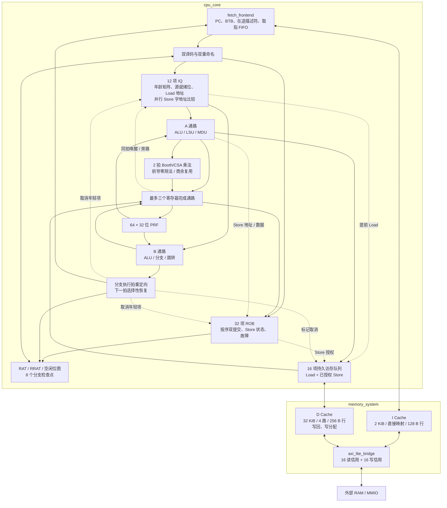
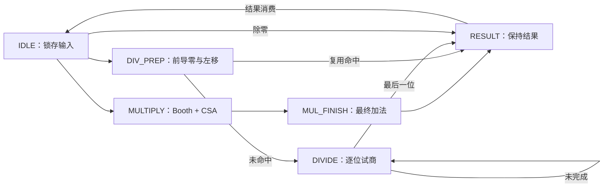
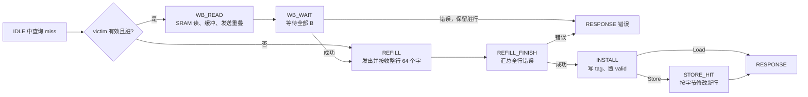

# V10 RV32IM 乱序 CPU 架构

本文描述 **2026-10-20 的 V10：Booth/CSA 与前导零乘除优化实现**。版本演进为 **V7 双通路 → V8 500 MHz 时序优化 → V9 乘法提前结束与商余复用 → V10 Booth/CSA 与前导零优化**；旧名称与文件对应见 [文档索引](README.md)。V8 对应 S23（`11d9ff5e539546d868889a59b449103229ad0040`），V10 在 V9 上将移位乘法替换为两拍 Booth/CSA 结构，为恢复除法增加前导零跳过，并保留商余复用、Store 转发匹配与 MQ 计数时序优化。所有默认参数以 [student_top.sv](../verilog/student_top.sv) 为准；内部模块单独声明的默认值用于兼容测试，不能当作整机默认配置。

这是一个采用 **物理寄存器重命名、乱序执行、按序提交**的 RV32IM 核心：最多每拍取两条、分配两条、选择两条、提交两条；A 通路执行整数、访存与乘除，B 通路执行整数与控制流。前端、执行后端和存储系统通过队列解耦。V8～V10 保留 V7 的窗口大小、Cache 配置及前端/访存流水拍数；V10 的乘除内部阶段和延迟见第 7.3 节。

| 最终验收指标 | V10 实测 |
| --- | ---: |
| 六项性能程序 IPC 几何平均 | **1.1002013686** |
| 课程 STA 估算最高频率 | **506.429278 MHz** |
| 最小可行周期 | **1.974609375 ns** |
| 2 ns 目标下最差 setup 裕量 | **+0.026140 ns** |
| 总面积，含 SRAM | **34,170.191 μm²** |
| 逻辑 / SRAM 面积 | **22,358.459 / 11,811.732 μm²** |

以上为当前 RTL 的课程 Linux 验收口径；源码摘要及结果见 [V10 验收 JSON](experiments/v10-results.json)，实现与对照过程见 [V10 实施记录](experiments/v10.md)。频率采用课程理想时钟、无布线寄生的 STA 模型，具体约束见第 16 节。历史实现见 [V7](experiments/v7.md)、[V8](experiments/v8.md)、[V9](experiments/v9.md)，时序优化过程见 [V8 方案](experiments/v8-plan.md) 和 [候选实验记录](experiments/v8-experiments.json)，本文按 V10 当前实现组织。

## 阅读导航

1. [指令集、启动与系统边界](#scope)
2. [总体结构与源码导航](#organization)
3. [默认资源与状态归属](#resources)
4. [前端：取指、队列与预测](#frontend)
5. [译码、重命名与物理寄存器](#rename)
6. [IQ 与双通路调度](#scheduler)
7. [执行、完成与结果旁路](#execution)
8. [ROB、提交与选择性恢复](#retirement)
9. [访存依赖、转发与持久请求队列](#lsu)
10. [Cache 与同步 SRAM](#caches)
11. [AXI4-Lite、MMIO 与退出](#bus)
12. [达到 500 MHz 的结构优化](#timing)
13. [典型指令的周期时序](#cycles)
14. [错误处理、复位与核心不变量](#correctness)
15. [参数化与兼容配置](#parameters)
16. [性能、验证证据与复现](#validation)

<a id="scope"></a>

## 1. 指令集、启动与系统边界

### 1.1 指令范围

| 类别 | 当前支持 |
| --- | --- |
| 整数运算 | ADD/SUB、移位、比较、按位逻辑及对应立即数指令，LUI、AUIPC |
| 控制流 | JAL、JALR、BEQ/BNE、BLT/BGE、BLTU/BGEU |
| Load | LB、LBU、LH、LHU、LW |
| Store | SB、SH、SW |
| M 扩展 | MUL、MULH、MULHSU、MULHU、DIV、DIVU、REM、REMU |
| 非法指令 | 不支持的编码生成故障记录，到 ROB 队首时停止 |

所有指令长 32 位，不实现压缩指令。数据按访问宽度自然对齐：字节不限、半字要求地址最低位为零、字要求最低两位为零。JALR 先清除目标最低位，再检查目标是否满足四字节指令对齐；条件分支检查实际下一 PC，未采用的分支目标不触发目标对齐故障。

当前不实现 CSR、FENCE、FENCE.I、ECALL、EBREAK、原子指令、特权模式、虚拟内存或陷阱处理程序。SYSTEM/FENCE 等未支持编码按非法指令处理。错误诊断与按序停止机制不能等同于完整的 RISC-V 特权异常体系。

### 1.2 启动与地址空间

- 顶层模块为 `student_top`，只有课程规定的 `clock`、高有效 `reset` 和 32 位 AXI4-Lite Master 端口。框架启动时复位保持 5 周期，复位 PC 为 `0x00000000`。
- 外部 RAM 为小端 256 MiB，范围 `0x00000000`～`0x0fffffff`。RTL 用 `addr[31:28] == 0` 判断可缓存 RAM。
- 其他地址走非缓存路径，由外部从机决定访问是否合法。课程规定的退出设备位于 `0x80000000`。
- 软件负责建立栈、初始化 BSS 等运行环境。当前官方启动代码设置 `sp = 0x00040000`，硬件不依赖测试程序名称，也不预置栈指针。
- 对退出地址进行完整 32 位 Store，`WSTRB=4'hf`，`WDATA` 为结果。仿真器在该写事务的 **B 通道握手**时结束，退出前脏数据排空属于程序运行周期的一部分。

I/D Cache 分离，无自修改代码维护协议，也没有多核或外部 DMA 一致性机制。非缓存访问的排序服务于课程内存与退出设备约定，不能据此推定任意有读副作用设备都支持安全的推测读取。

<a id="organization"></a>

## 2. 总体结构与源码导航

### 2.1 整机数据通路



图中表示逻辑职责。实际 RTL 没有独立的 `rename.sv`、`rob.sv`、`lsq.sv` 或 `store_buffer.sv`；这些状态集中在 `cpu_core.sv` 中，以字段数组和逐项更新逻辑实现。`student_top` 的两个主要实例是 `core` 与 `memory`，Cache 不位于 `cpu_core` 内部。

### 2.2 实际文件与模块职责

| 源文件 | 主要职责 |
| --- | --- |
| [student_top.sv](../verilog/student_top.sv) | 整机参数、有效取指宽度计算、核心与存储系统连接、课程端口 |
| [cpu_core.sv](../verilog/cpu_core.sv) | 双译码实例、RAT/RRAT、PRF、ROB、IQ、检查点、执行通路、访存排序与提交 |
| [frontend/fetch_frontend.sv](../verilog/frontend/fetch_frontend.sv) | PC 推进、双字取指、BTB/方向预测、请求身份、指令 FIFO、重定向取消 |
| [execute/decoder.sv](../verilog/execute/decoder.sv) | RV32IM 合法性、操作分类、源/目的寄存器属性及立即数 |
| [execute/alu.sv](../verilog/execute/alu.sv) | 整数 ALU；核心实例化两份 |
| [execute/muldiv_unit.sv](../verilog/execute/muldiv_unit.sv) | 单事务 Booth/CSA 乘法、前导零恢复除法、商余复用、背压与取消 |
| [common/address_adder.sv](../verilog/common/address_adder.sv) | 32 位并行前缀加法；供 ALU、地址生成、PC/分支目标使用 |
| [common/zero_one_tree.sv](../verilog/common/zero_one_tree.sv) | 平衡树判断候选向量中零个/恰一个置位，用于整数年龄选择 |
| [common/youngest_match.sv](../verilog/common/youngest_match.sv) | 环形 ROB 中最年轻匹配者的平衡树选择，用于逐字节 Store 转发 |
| [common/store_byte_align.sv](../verilog/common/store_byte_align.sv) | 按字节偏移摆放 Store 数据，与整数移位器保持结构独立 |
| [memory/memory_system.sv](../verilog/memory/memory_system.sv) | I/D Cache、AXI bridge 集成，写回/写穿配置选择 |
| [memory/icache_pipeline.sv](../verilog/memory/icache_pipeline.sv) | 四信用流水 I Cache、同步 SRAM、单缺失流水填行 |
| [memory/dcache_writeback.sv](../verilog/memory/dcache_writeback.sv) | 四信用写回 D Cache、替换、写分配、脏行排空、非缓存访问 |
| [memory/blocking_cache.sv](../verilog/memory/blocking_cache.sv) | 可选旧写穿路径：直接映射、写不分配、单请求阻塞；默认不实例化 |
| [bus/axi_lite_bridge.sv](../verilog/bus/axi_lite_bridge.sv) | I/D 读仲裁、响应归属、独立 AW/W 推进、读写信用 |

[verilog/filelist.f](../verilog/filelist.f) 是真实编译清单，公共模块在使用者之前列出。框架自动引入 [sram_fakeram.sv](../scripts/ram/sram_fakeram.sv)，不在清单中重复列出。验证平台位于 `verification/`，不改变官方顶层端口。

### 2.3 模块间接口与握手

内部传输在 `valid && ready` 的上升沿接受，消费方必须先具备保存请求或响应的容量。接口本身不携带事务 ID，身份由各自的有序描述符维护。

| 接口 | 请求/输入 | 响应/输出 | 身份与背压 |
| --- | --- | --- | --- |
| 前端 → 重命名 | `instruction_valid`、PC、指令、预测下一 PC、error；第二位置有对应字段 | `instruction_ready` 对应 `dispatch`，第二位置对应 `dispatch2` | 只消费实际成功分配的指令；第二条必须伴随第一条 |
| 核心 ↔ I Cache | `i_req_valid/ready/addr`，地址为取指 PC | `i_rsp_valid/ready/data/data2/error` | 每笔请求一个响应，可含两个指令字；前端请求描述符记录使用字数和取消身份 |
| 核心 ↔ D Cache | `d_req_valid/ready/write/addr/wdata/wstrb` | `d_rsp_valid/ready/data/error` | 地址已对齐到 32 位字；Load 的原字节偏移保存在 MQ，每笔读或写都返回一次响应 |
| Cache ↔ bridge | I/D 各自的 `mem_rd_*`，D 的 `mem_wr_*` | 对应 read/write response valid/ready 与 error | 请求单位为一个 32 位字，bridge 负责外部通道寄存与信用 |
| 核心 ↔ MDU | `req_valid/req_ready`、操作码和两源 | `result_valid/result_ready/result` | 核心保存唯一在途 ROB/目的身份，选择性 flush 可取消 |

取指到重命名、以及尚未接受的内部取指请求，可以被前端重定向取消；已接受 Cache 请求则必须排空。有效且被背压的事务载荷要保持稳定，只有无效候选载荷允许变化。Cache 的预读可以在 `req_valid=0` 时使用空闲 SRAM 端口，但只有真实请求握手才建立 `lookup_valid`，不会凭预读结果启动外部事务或写入缓存。

外部五个 AXI 通道分别为 AR（读地址）、R（读数据/响应）、AW（写地址）、W（写数据/字节掩码）、B（写响应）。这些外部有效事务不适用内部推测取消规则，详细实现见第 11 节。

<a id="resources"></a>

## 3. 默认资源与状态归属

### 3.1 整机默认配置

| 参数/资源 | 默认值 | 含义 |
| --- | ---: | --- |
| `FETCH_WIDTH / RENAME_WIDTH / ISSUE_WIDTH / COMMIT_WIDTH` | 2 / 2 / 2 / 2 | 各阶段峰值宽度，实际受类别和资源约束 |
| `ROB_DEPTH` | 32 | 未退休指令窗口 |
| `PRF_SIZE` | 64 | 32 位物理寄存器数，含固定为零的 p0 |
| `IQ_DEPTH` | 12 | 等待选择、或等待 Load 重试的指令槽位 |
| `LSQ_DEPTH` | 16 | 未退休 Load/Store 总数上限 |
| `MEM_QUEUE_DEPTH` | 16 | 已入队、尚未收到最终响应的持久数据事务数 |
| `BRANCH_CHECKPOINTS` | 8 | 同时未释放的控制流 RAT 快照数 |
| `FETCH_QUEUE_DEPTH` | 16 | 指令 FIFO 容量，单位为 32 位指令字 |
| `FETCH_OUTSTANDING` | 4 | 已接受但未返回的取指请求数，每笔可含两字 |
| `BTB_ENTRIES` | 64 | 直接索引、完整 PC 标签的 BTB 项数 |
| `LOCAL_HISTORY_BITS` | 1 | 每个 BTB 项的局部历史长度 |
| `RAS_DEPTH` | 0 | 默认关闭返回地址栈 |
| `ICACHE_BYTES / ICACHE_WAYS / ICACHE_LINE_BYTES` | 2048 / 1 / 128 | I Cache 共 16 行 |
| `DCACHE_BYTES / DCACHE_WAYS / DCACHE_LINE_BYTES` | 32768 / 4 / 256 | D Cache 共 32 组、128 行，每路 8 KiB |
| I/D Cache CPU 信用 | 各 4 | 已接受但未完成 CPU 响应的请求额度 |
| AXI 读/写信用 | 各 16 | bridge 内固定容量；读信用由 I/D 共享 |

`CACHE_LINE_BYTES=128` 是兼容参数，默认供 I Cache 使用；D Cache 显式使用 `DCACHE_LINE_BYTES=256`。不能把两个 Cache 都画成 128 B 行。

### 3.2 几类容易混淆的队列

| 状态 | 在何时分配 | 在何时释放 | 跨恢复行为 |
| --- | --- | --- | --- |
| 取指请求描述符 | I Cache 接受请求 | 对应响应被前端消费 | 错路项标记 killed，等待返回排空 |
| 指令 FIFO | 正确路径取指响应到达 | 指令被重命名接收 | 重定向时清空 |
| ROB | 指令重命名 | 按序退休 | 只取消误预测分支之后的项 |
| IQ | 指令重命名 | 普通指令被选择；Load 真正入队或故障执行 | 存活的老指令继续等待/重试 |
| LSQ 信用 `lsq_count` | Load/Store 重命名 | 对应指令退休 | 重新统计保留的访存指令 |
| 数据事务 MQ | Load 接受、或 Store 获得提交授权 | 对应 D Cache 响应消费 | 不删除描述符；年轻 Load 标记 killed |
| Cache 响应 FIFO | 查询/缺失产生响应且未直通消费 | 核心或前端消费 | Cache 不接收分支 flush，事务照常完成 |
| AXI 信用 | bridge 接受内部读/写请求 | R/B 响应消费 | 不受 CPU 分支恢复影响 |

**LSQ 是逻辑容量约束，不是另一份 16 项独立存储阵列。** 访存状态分布在 ROB 的 Store 地址/数据字段、IQ 的旧 Store 掩码，以及 MQ 的持久请求上下文中。RAM Store 退休会释放 ROB/LSQ，却仍可能占用 MQ；这正是两类容量必须独立计数的原因。

<a id="frontend"></a>

## 4. 前端：取指、队列与预测

### 4.1 一笔取指请求的内容

前端为每笔已接受请求记录：首字 PC、首字预测下一 PC、是否双字、第二字预测下一 PC，以及 `request_killed`。响应按请求顺序返回，前端以请求队首解释 `i_rsp_data/i_rsp_data2`，不根据当前 PC 猜测响应身份。

默认在以下条件同时满足时使用双字：PC 位于 RAM、按 8 B 对齐、首字没有预测采用的跳转、取指宽度为 2 且 RAS 关闭。第二字为 `PC+4`，也独立查询 BTB；若第二字预测跳转，下一请求转向它的目标，否则前进到 `PC+8`。PC 位于 8 B 组后半部或首字预测跳转时，只使用一个字。

双字来自同一个 64 位 SRAM 读组，不跨默认 I Cache 行。宽 SRAM 返回两字并不意味着每次都将两条指令入队，实际使用字数由已保存的请求描述符决定。

### 4.2 按字预留响应容量

前端同时跟踪已排队的指令字 `queue_count` 和在途请求预约的字数 `request_slots`：

```text
reserved_slots = queue_count + request_slots
```

每接受一笔请求，预留一或两个指令字的位置；每收到响应，归还相应预约。因此响应接收不依赖当拍译码是否前进，避免“取指响应等待译码、译码又等待取指”的死锁。

`RENAME_WIDTH=2` 时，当拍译码腾出的信用到下一拍才用于新请求准入，从而切断译码/分配到 I Cache 请求的长组合链。FIFO 的第一、第二队首采用旋转 one-hot 选择，减少二进制索引驱动宽字段的扇出。

`RESPONSE_BYPASS=1` 时，空 FIFO 可以把刚返回的一或两条指令直接送给译码；FIFO 中只有一条时，可把响应首字作为第二译码位置。未消费字仍进入 FIFO。直通只减少排队等待，不绕过响应身份与有效性检查。

### 4.3 BTB 与方向预测

默认预测器包含 64 项完整 PC 标签、目标地址、条件/无条件类型和两位饱和计数器。默认索引可写成：

```text
index = PC[7:2] XOR PC[13:8]
```

完整 PC 标签拒绝索引碰撞，因此冲突影响预测准确率，不改变指令语义。条件分支使用 bimodal 与逐分支局部预测混合：每项保存 1 位局部历史、两组两位方向计数器和两位 chooser。chooser 高位选择局部预测或 bimodal；两者预测不同时，按实际结果调整 chooser。无条件跳转在命中时预测采用目标。

默认 `TRAIN_EXECUTE=0`，只用按序提交的控制流训练。更新先进入一拍寄存的训练包，再以逐行 one-hot 使能写表；已提交更新不会被随后重定向取消。局部历史也只在提交训练时推进，因此无需随分支保存推测历史检查点。

RAS 的实现仍保留，支持 x1/x5 的 JAL/JALR 隐式 push/pop 提示、已提交栈与推测影子槽。但默认关闭；启用时顶层回退单字取指，与 RAS 无关的默认快路径才是本版本性能数据对应的结构。

### 4.4 重定向与旧请求排空

重定向清空指令 FIFO，并把此前已接受请求标为 killed；其响应继续按序消费，但不产生有效指令。同拍接受的目标路径请求会单独清除自己的 killed 位，不能误归到旧路径。

`REDIRECT_OVERLAP=1` 允许在旧响应未全部返回时，用尚可用的请求/字容量启动新路径。`REDIRECT_REQUEST=1` 且 RAS 关闭时，重定向当拍即可尝试目标 I Cache 请求；若 Cache 正在缺失或信用不足，仍须等待。不存在全局有限位宽 epoch 的回绕假设，描述符直到响应排空前都保留原取消身份。

<a id="rename"></a>

## 5. 译码、重命名与物理寄存器

### 5.1 译码结果与故障进入方式

两个 `decoder` 分别处理连续两条指令，输出操作类别、`rs1/rs2/rd`、源使用标志、目的写回标志、立即数和 `funct3`。操作编码约定为：0～11 是整数/LUI/AUIPC，12～14 是 JAL/JALR/条件分支，15/16 是 Load/Store，17 是 MDU，31 是非法。

非法编码不读取源、不分配目的物理寄存器，并携带 `FAULT_ILLEGAL`。取指错误携带 `FAULT_FETCH`。故障指令可以从第一位置进入 ROB，经过完成后等待队首诊断；第二位置发现非法或取指错误时停止双分配，留待它成为第一条处理。

### 5.2 RAT、RRAT 与 PRF

- `rat[32]` 保存当前推测路径的架构寄存器到物理寄存器映射。
- `rrat[32]` 保存已提交映射。提交更新 RRAT，执行完成本身不改变已提交映射。
- `prf[64]` 保存值，`prf_ready` 保存就绪状态，`free_regs` 是空闲位图，`committed_regs` 标记当前已提交映射占用的物理寄存器。
- 复位映射为 `xN → pN`，全部 PRF 值清零且就绪；p32～p63 空闲。p0 永远为零、就绪且不可分配/释放。

写寄存器的指令分配新的 `pdst`，记录当时的 `old_pdst`，并更新 RAT；新目的就绪位清零。完成时写 PRF、置就绪；提交时将 `pdst` 写入 RRAT，并释放 `old_pdst`。因此 WAW/WAR 不再阻碍乱序执行，真实 RAW 依赖由物理寄存器身份表示。

### 5.3 同拍双分配

第一条分配必须同时获得 ROB、IQ、必要的 PRF、LSQ 和控制检查点资源。第二条依赖第一条成功，还需剩余资源。第二位置支持整数、Load、Store、MDU 与控制流，但每拍最多分配一个控制检查点。

第二条的源和旧目的按程序顺序计算：

| 同组关系 | 处理 |
| --- | --- |
| 第二条读第一条的目的 | 源映射直接指向第一条新 `pdst`，等待第一条结果 |
| 两条写同一架构寄存器 | 第二条 `old_pdst` 等于第一条新 `pdst`，最终 RAT 指向第二条 |
| 第二条访存，第一条也是访存 | 同拍扣除两份 LSQ 信用 |
| 第二条 Load，第一条 Store | 第二条旧 Store 掩码包含第一条刚分配的 ROB 槽位 |
| 第一条控制流，第二条普通指令 | 允许双分配；检查点不包含第二条映射 |
| 第二条控制流 | 检查点包含第一条映射和第二条自身链接寄存器映射 |
| 两条都是控制流 | 只分配第一条 |

完成旁路同时参与重命名就绪判断和 Load 地址预计算，不要求已经到达的结果再等待一拍。新分配资源从当前空闲状态选出，不依赖同拍提交或选择释放的槽位形成长组合资源回收链。

<a id="scheduler"></a>

## 6. IQ 与双通路调度

### 6.1 每项保存什么

每个 IQ 槽位保存 ROB 身份、两个源物理寄存器、源就绪位、操作/目的/立即数/PC/预测载荷、指令类别、较老 Store 掩码，以及预先计算的 Load 有效地址。调度直接读取 IQ 载荷，不先选 ROB 索引再重新读取整份 ROB 字段。

`iq_older[k][q]` 表示有效项 k 比 q 更老。分配时更新两两年龄关系，同拍第一条比第二条老；槽位位置本身不代表程序年龄。候选项必须满足源就绪或同拍完成匹配，并满足类别相关条件：Load 不得越过地址未知的旧 Store，MDU 要等单元空闲，Load 正式准入还需要 MQ 信用。

Store 只需基址源就绪即可参与选择，数据源可稍后到达。Load 只有一个真正的源寄存器。数据来自未完成旧 Store 的情况在地址已知后进一步判定。

### 6.2 A/B 通路选择规则

| 通路 | 优先类别 | 空位填充 |
| --- | --- | --- |
| A | 从就绪访存、MDU 等非整数候选中选最老者 | 若 B 选择控制流，A 取最老整数；若 B 选择最老整数，A 取第二老整数 |
| B | 最老的就绪分支/JAL/JALR | 没有控制流候选时取最老整数 |

因此可以同拍选择双整数、整数+访存、整数+MDU、整数+控制流、访存+控制流或 MDU+控制流。不能同拍选择两条访存、两条 MDU、两条控制流，或访存+MDU。A/B 是执行通路分工，与双分配中的第一/第二指令位置无关。

若只存在一条整数，默认由 B 执行。A 的非整数优先、B 的控制流优先意味着整机不是简单地全局选最老两条；每类内部仍按年龄选最老就绪者。

### 6.3 零/一判定树

为了区分最老和第二老整数，调度器只需要知道某候选之前有零个还是恰一个就绪整数。V8 引入、V10 保留的 `zero_one_tree` 代替了完整人口计数：

```text
none = left.none AND right.none
one  = (left.one AND right.none) OR (left.none AND right.one)
```

12 项 IQ 补齐到 16 个叶节点，合并深度为 4 层。只计算实际所需谓词，避免逐项加法和进位链。非整数 Load 地址准备使用独立的 `primary_grant`，不经过整数第二老判定；它仍受更老 Store/MDU 候选的抑制，保证真正接收 Load 时与 A 通路选择一致。

### 6.4 Load 地址预计算与重试

若 Load 在分配时基址已就绪，`基址 + 符号扩展的 12 位立即数` 直接存入 `iq_load_address`。若稍后被完成结果唤醒，每项并行计算 `iq_wakeup_address`；同拍被选中的 Load 直接使用该地址，其余项把地址保存到 IQ。已经就绪的 Load 被选择时只需选择保存值，无需在年龄选择之后再串行读取 PRF、加法。

合法、自然对齐、无 Store 数据冲突、地址位于 RAM 且 MQ 有空位的 Load，可以通过 `SELECT_LOAD=1` 在选择拍直接入队。旧 EX 中若仍有 Load，它拥有载荷优先权，不能被新候选覆盖。

未能走提前路径的 Load 可以进入 EX；若因数据冲突或其他准入条件阻塞，它保留 IQ 项并释放 EX，之后重试。只有真正进入 MQ，或以故障指令完成后，才释放 IQ 项。这样旧 Store 的数据生产者仍能使用执行通路，不会被等待它的 Load 挡住。

<a id="execution"></a>

## 7. 执行、完成与结果旁路

### 7.1 两条寄存执行通路

普通指令先在选择拍读取操作数，锁存到 A 或 B 的执行寄存器，下一周期进行 ALU、分支判断或专用单元请求。这个寄存边界将调度/PRF 读取与普通执行分开；选择拍 Load 是明确的快速旁路例外。

A 通路拥有 ALU、地址生成、Store 数据准备和 MDU 请求入口。B 通路拥有第二个 ALU、分支比较及 JAL/JALR 目标计算。在单选择宽度的兼容模式中，控制流也由 A 通路处理。

两条通路各有两个主要操作数读取网络，PRF 由寄存器实现；Load 地址预计算另外使用重命名及完成旁路值，不能把整套结构理解成一块固定四读口 SRAM。源值可来自 PRF，也可直接来自同拍 Load/MDU、A 普通执行或 B 执行结果。旁路复用 IQ 内逐项身份比较，避免先把 grant 编码成源编号、再重新比较。

### 7.2 ALU 与地址计算

`alu` 完成加减、逻辑、比较、左右移、LUI 和 AUIPC。移位量只取低五位，有符号比较/算术右移明确使用有符号解释。AUIPC 的左操作数为指令 PC。

V10 沿用 V8 的 32 位位级并行前缀 `address_adder`：叶级形成 generate/propagate，按跨度 1、2、4、8、16 合并，最后生成各位进位与和。它处理模 $2^{32}$ 加法；ALU 减法用 `b XOR {32{subtract}}` 和初始进位实现。ALU、访存地址、链接地址与分支目标均使用这一结构，V7 的 16+16 位 carry-select 已在 V8 中替换。

具体采用 `G=A&B`、`P=A|B`，区间合并为 `G=G_high|(P_high&G_low)`、`P=P_high&P_low`，最后逐位计算 `A^B^carry`。用户提供的 `adder32` 使用 XOR 传播位及向量表达式，与当前结构同属五层并行前缀。已对参考式及两种 OR 传播变体做整机对照，三个候选均未达 500 MHz，因此仍保留原逐位实现；详见 [加法器对照实验](experiments/v10-adder-reference.md)。

B 通路并行准备 `PC+4`、`PC+imm` 和 `rs1+imm`。分支比较选出实际下一 PC，并与该动态指令携带的预测下一 PC 比较。JAL/JALR 的寄存器结果为 `PC+4`，实际跳转目标另存 ROB；JALR 目标最低位清零。

### 7.3 乘除法单元

`muldiv_unit` 同时只接收一笔事务。乘法内部划分压缩和最终加法两个阶段，除法划分归一化和试商阶段；这不意味着能够每拍接收一条新乘法。



**乘法。** 将两源按指令要求符号扩展或零扩展到 33 位：MUL 和 MULHU 均可零扩展，MULH 两源符号扩展，MULHSU 只对源 A 符号扩展。每三个相邻乘数位按 radix-4 Booth 编码生成 `0、+A、+2A、−A、−2A`，相邻编码组重叠一位，共 17 组；第 17 组保证无符号最高位正确。

每个部分积先在 34 位宽度内形成，再符号扩展到 64 位并左移 `2 × 组号`。负系数只取反，对应的加 1 位汇入独立修正行，避免每行各放一个进位加法器。17 行部分积和 1 行修正，经 `18 → 12 → 8 → 6 → 4 → 3 → 2` 六层 CSA 压缩；每个 CSA 输出 `S=A⊕B⊕C` 和左移一位的多数进位。第一拍寄存最终两行，第二拍做一次 64 位进位加法并按指令选高、低 32 位。乘法无需幅值转换或最终取负。

**除法。** 请求时保存两源幅值与符号；未命中复用时，`DIV_PREP` 通过 16/8/4/2/1 位二分检测和条件左移，将被除数的第一个 1 对齐到最高位，同时得到跳过的前导零数。迭代计数从该数开始，因此仅试算有效位。零被除数按跳过 31 位处理，执行一次零试商。有效位数使用 `floor(log2(x))+1`（非零 x），精确的 2 的幂也必须保留其最高有效位。

`DIVIDE` 每拍把余数和下一被除数位拼成 33 位数，减去零扩展的除数。恢复除法保持 `余数 < 除数`，因此试减值的 33 位符号足以决定商位：非负则保存差和商位 1，否则保留移入后的值和商位 0；不再单独做宽比较。最后商符号取两源符号异或，余数符号跟随被除数，同时生成两个经过符号修正的结果。

**复用与握手。** 一项记录保存两个原始操作数、signed/unsigned 模式及商和余数，支持 DIV/REM、DIVU/REMU 双向复用。原始 32 位操作数和模式必须完全一致；乘法、除零及未握手的输入变化不替换记录。匹配结果在请求时寄存，命中后在 `DIV_PREP` 返回所需结果，宽比较不进入请求到状态的组合路径。除零直接生成规定结果：DIV/DIVU 为全 1，REM/REMU 为原被除数。`RESULT` 保持结果直到消费，结果未消费时不接收新请求，也不在消费同拍接受下一请求。

| 运算路径 | 请求接收后，到结果有效所需的 MDU 时钟边沿 |
| --- | ---: |
| 乘法，包括零乘数 | 2 |
| 非零除数、未命中复用 | 1 拍归一化 + 1～32 次试商，共 2～33 |
| 非零除数、命中复用 | 1 |
| 除零 | 0，接收请求的边沿即进入 `RESULT` |

这些是单元延迟，不包含 IQ 等待、结果仲裁和退休时间。相较 V9，原本只需 1 拍的乘法现在需 2 拍；满 32 位被除数的未命中除法需 33 拍，短被除数则显著少于原来的 32 拍。`reset` 或 MDU `flush` 同时取消在途/未消费结果并清除复用记录有效位；完成边沿被取消时不能安装有效记录。测试覆盖符号/无符号边界、INT_MIN/−1、每个前导零边界、Booth 编码、复用、背压及各阶段取消，见 [执行单元验证](../verification/unit/EXECUTE.md)。

MDU 自身不携带 ROB 标签，核心保存 `mdu_rob/mdu_dst`。分支恢复只取消比误预测分支年轻的在途 MDU 事务；更老的乘除继续执行，其恢复拍到达的结果保持到后续消费。

### 7.4 三个完成通路

默认 `PARALLEL_COMPLETION=1` 时有：

| 完成通路 | 来源 | 冲突规则 |
| --- | --- | --- |
| 主完成口 `wb_*` | Load 或 MDU | 有效 Load 返回优先，MDU 等待 |
| A 普通完成口 `ex_wb_*` | A 的普通 ALU/故障完成等 | 不受 Load/MDU 仲裁阻塞 |
| B 完成口 | B 的整数或控制流 | 独立于前两口 |

所以同拍最多可完成三个不同目的寄存器，但峰值选择和提交宽度仍为 2。三个完成通路更新 PRF、ROB 完成/故障字段，并唤醒 IQ；Store 的地址/数据就绪和存储响应另走状态更新，不占寄存器结果口。

Load 与 MDU 同时返回时，只消费 Load，MDU 保持 `RESULT`。恢复拍关闭真实写回与新选择，并暂停数据响应消费；用于预计算的候选载荷和身份比较可以继续变化，但不授权状态修改。

<a id="retirement"></a>

## 8. ROB、提交与选择性恢复

### 8.1 ROB 保存的信息

ROB 用环形队列维护程序顺序，包含：有效/完成位、PC/指令、操作类别、架构目的/物理目的/旧映射、故障码、实际下一 PC、分支方向与目标、检查点编号，以及 Store 的地址、字节掩码、数据、源物理寄存器、地址就绪/已发送/响应完成状态。

二进制 `rob_head/rob_tail` 用于环形位置和年龄计算；`head_onehot` 及其旋转后的第二队首用于宽提交字段读取。完成可以乱序到达，队首未完成或有未处理错误时，后面的已完成指令不能越过它退休。

### 8.2 双提交条件

第一条必须有效、完成且无故障。非 Store 可直接退休；RAM Store 在获得 MQ 入队授权时即可退休；非缓存 Store 等待响应。第二条还要求第一条退休成功，并满足以下限制：

- 第二条完成且无故障，不能带尚待处理的重定向；第一条也不能触发提交恢复。
- 两条不能同时都是控制流，每拍最多一个预测器训练入口。
- 每拍最多一个 Store 入队。第二位置的 Store 只允许 RAM Store，且第一条不是 Store。
- 第一条若是 Store，必须属于可缓冲 RAM Store，才能带走第二条。

同拍同一架构目的的两次提交按程序顺序更新 RRAT，以第二条为最终映射。Load/Store 退休释放 LSQ 信用；RAM Store 的 MQ 项继续独立存在，不等待外部写回才能释放 ROB。

### 8.3 分支检查点的精确边界

默认每个已分配的分支/JAL/JALR 占用一个 RAT 检查点，直到退休或被更老分支取消。即使已经正确执行，也不立即释放检查点。

检查点必须表示“执行到该控制流指令之后”的映射：第一位置控制流包含自身目的映射、排除第二条年轻映射；第二位置控制流包含第一条映射和自身目的映射。这样 `JALR rd, imm(rd)` 能读取旧映射计算目标，同时在恢复后保留自己的新链接寄存器映射。

检查点保存映射，不复制整份 PRF 值或就绪位。恢复时从存活/取消集合推导资源回收，保留更老工作的真实完成状态。

### 8.4 执行拍重定向、下一拍后端恢复

默认开启 `EXECUTE_REDIRECT`、`EARLY_FETCH`、`EARLY_RECOVERY`。一次正常误预测的处理顺序是：

1. 控制流在执行阶段算出实际下一 PC，发现与预测不一致且无故障。
2. 当拍向前端发出目标；前端有资源时可在本拍接受新取指请求。后端记录恢复分支、目标和检查点，并阻止新的年轻选择。
3. 下一拍 `recovery_pending` 形成 `flush`。恢复 RAT，只取消比该分支年轻的 ROB/IQ 项，回收它们的新物理目的，重算 ROB/LSQ 数量，把 ROB 尾放在分支之后。
4. 清除该分支的待重定向标志，保留分支自身及所有更老指令。旧 Load 描述符、旧 Store 状态和旧 MDU 继续存活，年轻访存响应只排空。
5. 如果前端已在执行拍重定向，`recovery_prepared` 避免恢复拍重复清空已开始的新路径。

“更老”由相对当前 ROB 队首的环形顺序决定，不能直接比较槽号大小。年轻分支先执行后，仍可能被后来执行的更老误预测分支覆盖；最终存活边界必须服从更老分支。

### 8.5 恢复与异步结果的身份

仅用 ROB 槽号不足以识别晚到结果：被取消后槽位可能已分配给新指令。本实现为访存使用不可提前释放的 MQ 描述符，killed 状态持续到对应响应消费；为 MDU 显式取消年轻事务。取指也使用独立请求描述符。

因此恢复可以较早复用 ROB/PRF，而不会把旧响应写进新指令。恢复拍暂停 `d_rsp_ready` 和完成写回，存活响应下一拍再处理；已授权的 RAM Store 始终不可取消。仿真中的 64 位动态 trace ID 用于核验，不是硬件正确性的依赖。

<a id="lsu"></a>

## 9. 访存依赖、转发与持久请求队列

### 9.1 Store 地址与数据解耦

Store 的基址就绪后即可通过 A 通路计算有效地址、检查自然对齐、形成对齐字地址和字节写掩码。若数据已就绪，同拍保存数据并置 ROB done；否则保存数据源物理寄存器编号与字节偏移，标记地址已知，等待后续完成广播。

地址已知、数据未到的 Store 监听三个完成通路。命中源物理寄存器时，用 `store_byte_align` 将结果放到正确字节位置，再置 done。Store 计算完成只表示可供转发和提交，不会提前修改 Cache。被取消的 Store 失去有效身份，不能在 ROB 槽位复用后捕获旧源的晚到数据。

### 9.2 Load 能越过哪些 Store

每个 Load 分配时保存所有更老 Store 的 ROB 位掩码。Store 退休时清除对应位，避免槽位复用把新 Store 误认为旧依赖；恢复时也清除被取消的 Store 位。

| 更老 Store 状态 | Load 行为 |
| --- | --- |
| 地址未知 | 保守阻塞 Load 选择 |
| 地址已知、数据未知、不同 32 位字地址 | RAM Load 可以越过 |
| 地址已知、数据未知、同一 32 位字地址 | 等待数据，必要时留在 IQ 重试 |
| 地址和数据均已就绪 | 对命中字节转发，其余字节读 Cache |
| Store 已退休、仍在 MQ/Cache 中 | 依靠持久队列顺序和 Cache 更新维护可见性 |

未知数据的冲突判断以 **32 位字地址**为单位，即使字节掩码互不重叠，也会保守等待。当前没有内存依赖预测、越过未知地址 Store 的推测执行或违例回放机制。

### 9.3 逐字节最年轻旧 Store 转发

Load 入队时，对一个字的四个字节分别寻找：属于旧 Store 掩码、有效、完成、无故障、RAM 同字地址且相应 strobe 为 1 的 Store。每个字节独立选择其中程序顺序最年轻者，因此一次 Load 可以拼接多个 SB/SH/SW 的结果。

每个 IQ 项用自己的已保存/同拍唤醒地址，提前与旧 Store 的字地址并行比较。这些比较均为组合逻辑，与年龄选择并行。年龄选择产生 one-hot `primary_grant` 后，直接选出匹配位图，避免先选择 32 位地址、再广播到全部 Store 比较器的串行路径。这张位图同时供选择拍 Load 的数据未就绪冲突检查和转发使用；旧 EX Load 仍用自身地址与旧 Store 掩码比较。

`youngest_match` 以平衡淘汰树选择：相对 `rob_head` 已绕回低槽号的部分更年轻；同一部分内大槽号更年轻。32 项 ROB 的树深为 5 层。

MQ 独立保存逐字节匹配掩码，因此这里将 `ZERO_WHEN_INVALID` 置为 0：没有匹配的字节允许保存任意数据，响应合并时绝不会使用它。模块默认仍对无效结果输出零；两种配置都经过独立参考模型的形式等价检查。匹配字节和掩码在 Load 接受时保存到 MQ，之后即使来源 Store 退休、ROB 槽位复用，快照也不变化。

响应时按以下顺序形成结果：

```text
D Cache 返回的 32 位字
  → 用 MQ 快照覆盖命中字节
  → 按原有效地址低两位右移
  → 按 LB/LH/LW/LBU/LHU 扩展
  → 写回 Load 目的寄存器
```

即使所需字节全被转发，当前实现仍发送 Cache 请求并消费对应响应；没有“完全转发就省略访存事务”的额外路径。

### 9.4 MQ 的三个指针与事务生命周期

MQ 保存读写类型、对齐地址、写数据/掩码、ROB/目的身份、Load 偏移/宽度/转发快照，以及 killed/committed 状态。它按**接受顺序**发送、按相同顺序回收；Load 本身可以乱序选择，因此不能把 MQ 顺序等同于全部指令的程序顺序。

- `mq_tail`：下一笔入队位置。
- `mq_send`：下一笔尚未送给 D Cache 的请求。
- `mq_head`：下一笔待消费响应的原始上下文。
- `mq_count`：仍占有身份的全部事务数；`mq_unsent`：其中尚未送出的数量。

`mq_unsent` 的更新仍严格等于“旧值 + 本拍入队数 − 本拍发送数”。硬件提前从旧值生成 `−1、+1、+2` 三个候选，最后由 Load/Store 入队和 Cache 握手选择净变化，避免晚到握手再经过串行加减。零净变化保持旧值，容量约束与指针推进规则不变。

D Cache 接受请求只推进 send，不释放描述符。消费响应才推进 head、释放容量。普通分支 flush 不重置这些指针，也不删除已发送或尚未发送的 Load；取消项仍可以进入 Cache 并排空，但不得产生有效 Load 写回。RAM Store 入队后标记 committed，完全脱离 ROB 槽位的后续生命周期。

### 9.5 同拍 Load 与 Store 入队

Load 有准入优先权。`PARALLEL_STORE_ENQUEUE=1` 且至少有两个空槽时，一条 Load 和一条正在提交的 RAM Store 可以同拍入队：Load 占 tail，Store 占下一个位置。

这个特例中，较老 Store 在 MQ 中可能排在该 Load 后面。正确性由 Load 在同拍保存 Store 的逐字节转发快照保证，不能只靠队列先后关系解释。后续 Load 已位于该 Store 之后，继续由有序发送和 Cache 更新维护关系。非缓存 Store 不参与这个双入队路径。

### 9.6 入队到 Cache 的同拍旁路

`LOAD_REQUEST_BYPASS=1` 时，若没有旧的未发送 MQ 项，合格 RAM Load 可在预约持久上下文的同一个时钟沿交给 D Cache。若 Cache 不 ready，Load 仍已保存在 MQ，之后按正常 send 指针重发，身份和载荷不丢失。

必须区分三个动作：准备地址、`load_enqueue` 授权占有 MQ、`d_req_valid && d_req_ready` 授权 Cache 接收。已有未发送请求时，它始终拥有数据端口；仅当 `mq_unsent==0` 才准备新 Load 载荷，最终 valid 再由对齐、地址范围、Store 冲突、容量和恢复状态决定。空闲周期地址可以变化，已接受或被背压的真实事务不能被候选载荷覆盖。

<a id="caches"></a>

## 10. Cache 与同步 SRAM

### 10.1 默认几何与物理存储

| 项目 | I Cache | D Cache |
| --- | --- | --- |
| 容量 / 相联 | 2 KiB / 直接映射 | 32 KiB / 4 路 |
| 行长 / 每行字数 | 128 B / 32 字 | 256 B / 64 字 |
| 组数 / 总行数 | 16 / 16 | 32 / 128 |
| 地址划分 | tag `[31:11]`，set `[10:7]`，行内偏移 `[6:0]` | tag `[31:13]`，set `[12:8]`，行内偏移 `[7:0]` |
| 数据 SRAM | 256 × 64 位，32 位写粒度 | 每路 2048 × 32 位，8 位写粒度 |
| 标签 SRAM | 16 × 21 位 | 每路 32 × 19 位 |
| 寄存元数据 | valid 位 | valid/dirty 位、每组轮转替换指针 |
| 缺失能力 | 一个活动缺失 | 一个活动缺失 |
| CPU 请求信用 | 4 | 4 |

D Cache 同组地址间隔是每路容量 **8 KiB**。32 KiB 是四路总容量，不是单路容量。

SRAM 都是同步单端口 1RW：上升沿读入地址后，下一周期使用结果；同一实例每拍只能读或写。写周期和禁用周期的输出未定义，不能当作保持寄存器。控制器必须及时消费或保存有效读结果；背压依赖显式 FIFO。

默认 SRAM 在模型中拆为 I Cache 两个 256×32 数据 lane 与一个 tag lane，D Cache 每路四个 2048×8 数据 lane 加一个 tag lane，共 23 个 SRAM lane。PRF、ROB、IQ、预测器、检查点及有效/脏位属于寄存器逻辑，不计入 SRAM 容量。接口细节见 [SRAM 说明](sram.md)。

### 10.2 I Cache 命中与缺失

请求接收时并行查询 tag 和 64 位数据 SRAM，记录 `lookup_address/lookup_valid`。命中时选择对应首字；对齐双字请求同时返回后一个字。命中流水可每拍接收一个请求，前端最多从中得到两条指令。

`FAST_INSTRUCTION_RESPONSE=1` 时，响应 FIFO 为空即可直接暴露已完成的同步查询结果；若下游背压，在下一沿把相同响应保存入 FIFO。这里的直通没有取消 SRAM 的同步读周期。

检测到 miss 后停止接收新请求，沿整行顺序发出 32 个四字节读，issued/received 分开推进，允许多个字读在 AXI 中飞行。请求字及第二字暂存；只有全行响应都返回、所有错误都汇总后，才安装有效 tag 并返回 miss 响应。不做关键字先返回，也不在填行未完成时恢复 CPU 请求接收。

I Cache 在 RAM 之外使用一次非缓存读。对齐错误产生错误响应而不发起对应外存访问。错误路径取指仍可完成合法 Cache 填充，前端根据请求身份丢弃指令即可。

### 10.3 D Cache 命中流水

D Cache 在请求接收沿并行查询各路 tag；Load 同时读取各路数据。自 V8 起，各路 valid 位与同步 tag 一起采样，命中比较直接使用配套的 `lookup_line_valid`，不再串行经过旧请求组索引的 valid 选择。

Load 命中数据由四路命中位直接掩码 OR 得出，避免 `hit → 编码 hit_way → 数据选择` 的串行链。`hit_way` 仍用于 Store 写路等控制用途。`FAST_HIT_RESPONSE=1` 在 FIFO 空时直通同步命中结果，背压时保存；miss 和写回错误仍使用完整验证后的注册响应路径。

`PIPELINED_STORE_HITS=1` 时，Store 首先只读 tag，不占用数据阵列读取。其命中周期写选中路的数据 SRAM，并可同时为下一条 Store 查询 tag，因而连续 Store hit 可以逐拍接收/更新。Store 后紧接 Load 时，Load 需要数据读口，必须让出前一 Store 的写入沿，存在必要的单端口隔离。不能把连续 Store 吞吐推广成任意 Load/Store 序列都无气泡。

四份 CPU 信用覆盖响应 FIFO、活动 lookup 或一个 miss 的最终响应位置。D Cache 用已寄存的 `cpu_count` 控制准入，避免响应 ready 串到请求路径；信用耗尽时，即使当拍消费一个响应，也可能要等下一拍再利用该空间。

### 10.4 替换、写回与写分配

缺失优先选择编号最小的无效路；所有路都有效时使用每组 round-robin 指针，并且只在成功 INSTALL 后推进。它不是 LRU。



Store miss 使用写分配：先读取整行，确保未覆盖字节保留，然后按 Store strobe 更新数据并置 dirty。Load/Store miss 都要等待整行完成，不能通过增加 AXI 信用让 Cache 同时管理多个缺失。

脏行写回用四字 FIFO 解耦同步 SRAM 与 AXI：读请求预占一个 FIFO 槽，下一沿捕获读数据，再按行内顺序发送。SRAM 读、捕获、发送可重叠，理想情况下达到每拍一个 32 位字；AXI 背压时数据保存在 FIFO 中。读出一行、发出一行和收到所有 B 是三个不同进度，只有最后一步全部成功才允许清脏。

### 10.5 Cache 错误与非缓存刷新

若写回任一 B 返回错误，控制器继续完成该次整行发送并排空响应，保留完整原 victim 数据、tag、valid 和 dirty；不填入替换行，也不继续发后续 MMIO。触发此次写回的请求收到错误。外存可能已接受部分字写，保留整行脏副本为后续完整重试提供依据。

填行的 R 错误也要等全部响应排空再报告，不能安装有效的新行。已写入的部分数据没有有效 tag，不会作为命中返回。

所有非缓存 D 访问先扫描全部 128 行。按路和组枚举，发现脏行进入同一写回流程，成功清脏后继续；每八行构成一组，在组边界发现全清洁即可一拍跳过八行。扫描成功后进入 `BYPASS_REQUEST/BYPASS_RESPONSE` 执行原非缓存事务。刷新清脏但保留有效的缓存数据，错误时中止后续访问。

<a id="bus"></a>

## 11. AXI4-Lite、MMIO 与退出

### 11.1 读通道：共享信用与响应路由

`axi_lite_bridge` 将 I/D Cache 的字读合并到一个 AR 通道。双方同时请求时，按上一次接受的来源轮换优先级；单方请求时直接服务该方。仲裁发生于内部请求被接受时。

AR 有一个寄存待发槽，受到背压时地址与 valid 保持。16 份读信用包括这个待发槽和已经完成 AR、仍未消费 R 的请求。AR 握手后，将来源 I/D 记入 owner FIFO；R 按队首来源送回对应 Cache，只有该 Cache ready 才拉高 RREADY。无事务 ID，因此依赖同一读通道的有序响应；队首接收方阻塞时会阻塞后续读响应。

整行填充是多个独立四字节 AXI4-Lite 事务，不是 AXI burst。I/D 各有一个活动缺失时，可以交错使用这 16 份总线信用。

### 11.2 写通道：AW 与 W 独立前进

写队列保存 16 份地址、数据和 strobe，D Cache 是唯一内部写来源。`aw_head/aw_count` 与 `w_head/w_count` 分别推进，两侧都保持各自 FIFO 顺序；允许 AW 先握手、W 先握手，或相距多拍。

写信用从内部接受时占有，直到 B 被消费才归还；不能在 AW 或 W 接受时提前释放。只有至少一笔地址和数据都已发出的配对存在时才接收 B。所有非 `OKAY` 的 RRESP/BRESP 都映射成内部 error。

读写通道彼此独立。分支恢复不会撤回已声明的 AXI VALID，也不会清除已接受的 AXI 事务；CPU 在上层判断结果是否仍属于有效指令。协议说明见 [AXI4-Lite 文档](axi4-lite.md)。

### 11.3 非缓存排序与退出路径

MQ 发送非 RAM 请求前，必须确认其之前的已发送事务全部响应完成，即不能在仍有旧的 sent 项时将该请求交给 D Cache。更老已退休 Store 即使已离开 ROB，仍受这条规则覆盖。

非缓存 Store 只从 ROB 第一提交位置授权，不允许作为第二提交 Store，也不使用 RAM Store 的入队即退休规则。非缓存 Load 不走选择拍 RAM 快路径，需等待较老 Store 依赖清空，再从 EX 进入 MQ；当前没有进一步要求所有非缓存 Load 等到 ROB 队首，所以适用范围是本课程的设备契约。

退出完整路径为：

```text
退出 Store 到达 ROB 队首、地址/数据就绪
  → 授权进入 MQ，保持未退休状态
  → 等更老 MQ 事务响应完成
  → D Cache 扫描全部行并写回脏数据
  → 等全部写回 B 成功
  → 发送 0x80000000 的 AW/W，WSTRB=0xf
  → 外部从机在退出写 B 握手时结束仿真
```

核心逻辑正常情况下会等非缓存写响应后释放 Store，但退出仿真可能在该响应传回核心之前已经终止。验证轨迹因此区分 Store 授权与实际 ROB 退休，不能把日志中的一次 Store 提交事件简单理解为外部写已完成。

<a id="timing"></a>

## 12. 达到 500 MHz 的结构优化

### 12.1 原瓶颈与优化边界

原 V7 的最小周期为 3.1767578125 ns，关键组合依赖横跨 D Cache 命中、Load 完成唤醒、IQ 选择、下一条 Load 地址生成、准入和 SRAM 地址。原分析中最差路径从 D Cache 地址寄存器出发，经过后端再回到数据 SRAM；仅调整 SRAM 末级驱动不足以收敛到 2 ns。


这是 RTL 依赖关系示意，具体候选的关键路径仍以该次综合网表为准。最终优化没有增加 Load 命中、执行或恢复的流水拍数，也没有缩小 Cache 或指令窗口；六项性能周期与原 V7 完全相同。

### 12.2 最终保留的改动

| 改动 | 具体结构 | 缩短的依赖 |
| --- | --- | --- |
| 整数年龄判定 | `zero_one_tree` 只算 none/one | 消除只为判断 0/1 而构造的串行计数链 |
| Load 地址准备 | `primary_grant` 与整数填充选择分开，IQ 保存就绪地址，同拍唤醒并行算地址 | 地址不再等待通用选择、源编码和完整 AGU 串行完成 |
| 地址与授权分离 | 旧 MQ/旧 EX 的载荷归属先决定，valid 最后决定是否接收 | 恢复、信用、别名判断不必驱动所有宽数据选择 |
| Load 立即数收窄 | 选择真正的 12 位 I 型立即数后恢复符号扩展 | 无关 U/J 型高位不进入 Load 加法选择网络 |
| 完成身份并行比较 | MQ 队首 one-hot 与逐项目的比较同时展开 | 消除先选二进制目的、再广播比较的串行层次 |
| Store 字地址比较 | 每个 IQ 候选提前比较，年龄选择直接选匹配位图 | 地址比较与选择重叠，缩短选择到冲突判断及转发的路径 |
| 转发选择 | 四棵 `youngest_match` 平衡树，MQ 掩码独立保存有效性 | 避免长优先链，去掉不影响结果的无效数据清零门控 |
| MQ 待发送计数 | 提前生成净增减候选，握手只选择结果 | 避免缓存 ready/valid 后串行完成计数加减 |
| 通用算术 | 位级 `address_adder` 并行前缀网络 | 缩短加法并限制综合资源共享引入的晚到控制 |
| Store 数据摆放 | 独立 `store_byte_align` 选择器 | 防止 Store 准入逻辑通过共享移位器串入 ALU 旁路 |
| D Cache 命中 | valid 与 tag 同步预读、直接命中位选数据 | 缩短命中判定及命中到返回路径 |
| 标签与 SRAM 地址 | `install_tag` 仅在接收时保存；各路按已知操作准备地址 | 降低命中比较寄存器的写端扇出，推迟写授权而提前地址 |
| 前端重定向 | 在误预测比较完成前准备分支实际目标，前端查询与比较重叠 | 不把 32 位预测比较串在目标地址选择之前 |
| 宽状态更新 | 逐项写使能、无效槽预采样、队首 one-hot | 减少全局恢复/ready 控制在宽载荷上的扇出 |

“载荷可提前准备”只适用于尚无有效事务的槽位或已知所有者的数据网络。置 valid、分配信用、修改 PRF、写 Cache、发送总线事务仍受完整授权条件控制。这一原则贯穿前端 FIFO、ROB/IQ 空槽、MQ、MDU 空闲载荷和 Cache 预读。

### 12.3 有记录的阶段结果

| 阶段 | 结构变化 | 频率 MHz | 总面积 μm² |
| --- | --- | ---: | ---: |
| V7 | 双通路，500 MHz 优化基线 | 314.786351 | 30,717.501 |
| V8 候选 S1 | 仅替换整数零/一年龄判定 | 333.441876 | 30,731.031 |
| V8 候选 S2 | S1 上分离提前 Load 载荷与准入 | 341.333333 | 30,892.578 |
| V8（S23） | 首轮 500 MHz 优化完成 | **504.185130** | **32,287.898** |
| V9 | 乘法提前结束、商余复用，前移 Store 比较并预计算待发送计数 | 501.469148 | 33,800.573 |
| V10（当前） | 两拍 Booth/CSA 乘法、除法跳过前导零 | **506.429278** | **34,170.191** |

28 个实测候选中包含退步对照，不能假设每次局部修改都会加速。S22 到 S23 的最后一步在不增加拍数的情况下将频率从 471.021159 MHz 提升到 504.185130 MHz。源码归属、父候选和具体指标见 [候选实验记录](experiments/v8-experiments.json)；[S1](experiments/v8-s1.patch)、[S2](experiments/v8-s2.patch) 补丁只用于复现早期单项实验，不是当前完整实现。

<a id="cycles"></a>

## 13. 典型指令的周期时序

以下把两个上升沿之间记为一个周期 C，握手/寄存更新发生在该周期末沿。表格假定操作数及资源可用、没有更老阻塞、Cache 命中且响应 FIFO 为空，用于解释最短内部路径，不是对任意程序的固定延迟承诺。

### 13.1 普通 ALU 与依赖指令

| 周期 | 指令 I：整数 ALU | 依赖 I 的指令 J |
| --- | --- | --- |
| C | IQ 选择，读取或旁路操作数，末沿进入 A/B EX | 尚未就绪 |
| C+1 | EX 计算，末沿写 PRF/ROB done | 同拍收到结果匹配，可选择并锁存旁路操作数 |
| C+2 | 若在 ROB 队首且无阻塞，可以提交 | 在 EX 执行并完成 |

完成结果可直接唤醒下一条，不需要先写 PRF、再额外等一拍读取。两条当拍新选中的 RAW 依赖指令不能互相即时执行；同拍旁路来源是正在完成的更早指令。

### 13.2 选择拍 Load 与依赖 Load

| 周期 | Load L0 | 依赖 L0 的下一条指令 |
| --- | --- | --- |
| C | 从 IQ 保存/唤醒地址选择，检查准入，末沿同时入 MQ 并启动 D Cache 同步查询 | 等待 L0 |
| C+1 | D Cache 命中，合并转发字节并扩展，末沿完成写回 | 同拍被唤醒；若也是合格 RAM Load，可并行算地址并于末沿启动自己的查询 |
| C+2 | 若到队首可提交 | 前拍已启动的下一 Load 可返回；普通消费者在 EX 执行 |

这条“命中返回 → 唤醒 → 下一 Load 查询”的连续路径解释了为什么提高频率不能简单给 Load 普遍加一拍。若 MQ 有旧未发送项、Cache miss、旧 Store 冲突或信用不足，Load 进入排队/重试路径，不能套用上述时序。

### 13.3 Store 地址早到、数据晚到

```text
C：Store 基址就绪，被选择进入 A
C+1：计算地址，ROB 标记地址已知；数据尚未就绪，不置 done
之后：不同字地址 Load 可以越过；同字 Load 继续等待/重试
生产者完成拍：ROB 按源物理寄存器捕获 Store 数据，置 done
到达提交位置：Store 进入 MQ；RAM Store 同拍退休
随后：MQ 发送、D Cache 更新，响应到达后释放描述符
```

Store 进入 MQ、Cache 变脏和脏行写回外存是不同事件。写回 Cache 的目的正是允许多数 Store 在局部命中更新后结束事务，而不逐条等待外部 AXI 写。

### 13.4 误预测的前后端重叠

| 周期 | 后端 | 前端 |
| --- | --- | --- |
| C | 控制流被选入 B 通路 | 继续预测取指 |
| C+1 | 算出误预测，记录检查点恢复请求，完成分支 | 当拍清空旧指令、标记旧请求，资源允许时接受目标取指 |
| C+2 | 恢复 RAT 和窗口，暂停提交/写回/响应消费 | 已启动的目标 I Cache 命中可返回并保存，不重复重定向 |
| C+3 | 恢复后的重命名/执行继续 | 可向重命名提供正确路径指令 |

目标取指命中只代表这一示例的最快情形。旧请求占满信用、I Cache 活动缺失或目标 miss 都会拉长前端恢复时间；“执行拍重定向”不等于固定一拍误预测代价。

<a id="correctness"></a>

## 14. 错误处理、复位与核心不变量

### 14.1 故障归属

| 故障码 | 来源 | 处理方式 |
| --- | --- | --- |
| `FAULT_FETCH = 1` | I Cache/总线取指错误 | 指令携带故障进入 ROB，到队首停止 |
| `FAULT_ILLEGAL = 2` | 非法或未支持编码 | 无架构目的分配，到队首停止 |
| `FAULT_ALIGN = 3` | 访存自然对齐或实际控制流目标对齐错误 | 不发起该错误访存，完成故障记录后按序停止 |
| `FAULT_LOAD = 4` | 有效 Load 的 D Cache/总线错误 | 按 MQ 保留的原 Load 身份写入 ROB 故障 |
| `FAULT_STORE = 5` | 尚未退休的串行 Store 响应错误 | 在原 ROB 项记录故障 |
| 已退休 RAM Store 的晚到错误 | 缓冲 Store、其触发的写回/填行错误 | 设置 halted；仿真按持久 trace 上下文报告原 PC/指令 |

普通故障只有到达 ROB 队首才使核心停止，因此错误路径上的非法指令、Load 错误等可先被更老分支取消而不影响有效路径。故障指令不提交，后续年轻指令也不能越过它提交。

RAM Store 已退休后才收到的错误采用**异步错误契约**：它可能到达时更年轻指令已经退休，核心不能回滚这些架构变化。这不是精确 Store 陷阱。原 PC/指令等详细诊断上下文位于仿真 trace 状态，综合后的核心以持久事务状态和 halted 控制停止行为。

`halted` 停止新的分配、选择、写回和提交，不表示直接清空存储系统。已经授权的 RAM Store 和已接受的 Cache/总线事务仍可排空，避免把停止执行误实现成撤销对外事务。

### 14.2 复位和 SRAM 内容

复位清空有效位、队列计数、预测有效状态、检查点和流水事务，初始化寄存器映射。Cache 通过清 valid/dirty 使旧 SRAM 内容不可命中，不逐字清 SRAM。外部镜像未初始化字节为零，与片上 SRAM 上电内容无关。

很多宽载荷寄存器允许在无效状态下预采样，其正确性由有效位、握手和所有者保证，不要求所有无效数据都清零。运行中复位会丢弃脏缓存及内部事务状态，当前只支持课程的整机启动复位契约，不保证运行中复位保存脏数据。

### 14.3 实现与验证共同维护的不变量

1. x0 始终映射 p0，p0 值为零、就绪且不在空闲集合。
2. 每个活跃目的物理寄存器有唯一生产者；重命名、提交释放和恢复回收不能重复分配或释放。
3. 选择可以乱序，提交必须保持程序顺序；第二分配/提交必须伴随第一分配/提交。
4. A/B grant 各至多一个，不能选择同一动态指令两次；Load 重试必须发生在真正接受之前。
5. Store 只在按序获得不可撤销授权后到达 Cache，恢复不能取消已授权 RAM Store。
6. Load 转发只能来自程序顺序更老的有效 Store，每个字节取其中最近写者。
7. MQ 描述符直到响应排空才释放，killed Load 不能完成或写回任何新复用的 ROB/PRF 身份。
8. 检查点对应正确控制流及映射边界；恢复保留分支自身和更老项的实际就绪状态。
9. Cache 和 AXI 只能在拥有响应容量时接收请求；SRAM 单端口所有者互斥，禁止使用失效读输出。
10. 已对外声明的 AXI 有效事务在背压下保持载荷，AW/W 独立推进仍保持配对顺序，写信用只由 B 回收。
11. 写回错误不能清脏或安装替换行，退出 MMIO 只能在更老事务及脏行成功排空后发送。
12. 无效槽预读/预采样不产生架构效果；真正的更新以有效状态和授权握手为准。

这些规则在 RTL 运行时断言、逐提交参考模型、访存身份检查和单元背压/故障注入中分别覆盖。局部形式等价证明用于算术及选择网络，不代表已经形式证明整个乱序核心。

<a id="parameters"></a>

## 15. 参数化与兼容配置

### 15.1 默认功能开关

| 参数 | 默认 | 控制的行为 |
| --- | ---: | --- |
| `DCACHE_WRITE_BACK` | 1 | 使用写回/写分配 D Cache |
| `FAST_HIT_RESPONSE` | 1 | D Cache 同步命中结果直通空响应 FIFO |
| `PIPELINED_STORE_HITS` | 1 | 连续 Store 的 tag 查询与数据写重叠 |
| `FAST_INSTRUCTION_RESPONSE` | 1 | I Cache 同步命中直通 |
| `PREDICT_ENABLE` | 1 | 启用预测和训练 |
| `BTB_INDEX_XOR` | 1 | 折叠 PC 字段形成 BTB 索引 |
| `REDIRECT_OVERLAP` | 1 | 旧取指响应排空与新路径请求重叠 |
| `RESPONSE_BYPASS` | 1 | 取指响应直通译码空位 |
| `REDIRECT_REQUEST` | 1 | 重定向当拍尝试请求，要求 RAS 关闭 |
| `SELECT_LOAD` | 1 | 合格 Load 在选择拍进入 MQ |
| `LOAD_REQUEST_BYPASS` | 1 | MQ 没有旧待发项时，新 RAM Load 入队同拍进 Cache |
| `PARALLEL_STORE_ENQUEUE` | 1 | 两个空槽时允许 Load 与 RAM Store 同拍入队 |
| `EXECUTE_REDIRECT` | 1 | 提前恢复开启时，执行拍直接重定向前端 |
| `EARLY_FETCH / EARLY_RECOVERY` | 1 / 1 | 执行阶段发现误预测，提前取指并选择性恢复后端 |
| `PARALLEL_COMPLETION` | 1 | A 普通执行拥有独立完成口 |
| `TRAIN_EXECUTE` | 0 | 默认在提交训练；非零且 RAS 关闭时切换实验性执行训练 |
| `TRACE` | 0 | 默认关闭验证事件输出；相关调试逻辑不参与综合 |

有些开关共同决定实际路径。例如 `EXECUTE_REDIRECT` 要与 `EARLY_RECOVERY` 配合才形成直接执行拍重定向；`PARALLEL_COMPLETION=0` 合并 A/Load/MDU 的主完成仲裁，双选择模式的 B 通路仍独立，不能只凭“single-completion”测试名称推断整个核心只有一个写回源。

### 15.2 合法范围与退化路径

- 取指、重命名、选择、提交宽度支持 1/2，不支持任意超标量宽度。
- `ROB_DEPTH >= 2`、`PRF_SIZE >= 33`、`IQ_DEPTH >= 1`、`1 <= LSQ_DEPTH <= ROB_DEPTH`，MQ 和检查点容量至少为 1。`PRF_SIZE >= 32 + ROB_DEPTH` 有助于减少寄存器容量先于 ROB 耗尽，但不是正确性必要条件。
- ROB、IQ、MQ、检查点、取指 FIFO、在途取指数支持非二次幂容量；环形指针显式回绕。BTB 支持 1～65536 项，对非二次幂索引进行折叠；局部历史长度支持 0～4。
- Cache 容量/行长必须是合法二次幂，每个 Cache 总容量不超过 2 MiB；行长至少 4 B，不能超过单路容量。I Cache 只支持一路；写回 D Cache 支持 1/2/4 路，写穿 D Cache 只支持一路。
- I Cache 容量或行长小于 8 B，或 `RAS_DEPTH != 0` 时，顶层 `EFFECTIVE_FETCH_WIDTH` 自动回退为 1。
- 关闭写回时实例化 `blocking_cache`，采用写穿、写不分配、单请求阻塞，不能沿用默认写回缓存的命中时序说明。
- 关闭提前恢复时，误预测分支到提交后再统一恢复 RRAT；这条兼容路径与默认的检查点选择性恢复不同。

顶层参数会逐级传递，内部模块的历史默认值只有单独实例化时才生效。官方 Make 接口没有通用 RTL 参数覆盖参数；定向构建器支持 `--param NAME=VALUE`，参数实验应记录完整配置和源码摘要。

### 15.3 已验收的兼容组合

| 配置 | 主要变化 | 用途 |
| --- | --- | --- |
| `small` | ROB=5、PRF=37、IQ/LSQ/MQ/检查点=3、取指 FIFO=5、BTB=5、RAS=3、小 Cache | 验证非二次幂回绕、小容量背压和单字回退 |
| `scalar` | 四种宽度均为 1 | 验证单宽实现 |
| `legacy` | 关闭提前恢复与 A 并行完成 | 验证提交恢复和共享完成仲裁 |
| `no-early` | 关闭选择拍 Load、执行拍直接重定向及重定向当拍请求 | 验证普通请求/重定向路径 |
| `single-completion` | 仅关闭 A 并行完成，仍提前恢复 | 验证受阻旧 EX 跨恢复保留及完成冲突 |

以上五组各完成 189 次功能回归。兼容配置保留架构提交、身份、转发与恢复检查，但跳过依赖默认窗口的部分时序覆盖；不能据此宣称任意参数组合都满足 500 MHz 或相同 IPC。

<a id="validation"></a>

## 16. 性能、验证证据与复现

### 16.1 六项性能与测量口径

测试子模块固定为 `29f980727f7d99a1842a58f34091c7579ba3fe85`。外存 `LATENCY=10`，使用官方程序的动态指令数除以仿真运行周期，再对六项精确 IPC 取几何平均：

$$
IPC_{geo}=\left(\prod_{i=1}^{6}\frac{instructions_i}{cycles_i}\right)^{1/6}
$$

| 程序 | 动态指令数 | 周期 | IPC |
| --- | ---: | ---: | ---: |
| `perf_median` | 6,961 | 8,624 | 0.807166 |
| `perf_multiply` | 21,722 | 16,694 | 1.301186 |
| `perf_qsort` | 139,900 | 132,395 | 1.056686 |
| `perf_rsort` | 195,719 | 121,282 | 1.613751 |
| `perf_towers` | 5,278 | 5,317 | 0.992665 |
| `perf_vvadd` | 4,524 | 4,535 | 0.997574 |
| 几何平均 | — | — | **1.1002013686** |

周期包含框架启动、Cache 填行和退出排空，不是只统计稳定执行区间。`TRACE=0` 官方构建与 `TRACE=1` 验证构建的六项周期一致，六项逐提交比较覆盖 374,104 条提交。V8、V9、V10 与 V7 的六项周期逐项相同。

### 16.2 综合与时序约束

| 项目 | 最终验收配置 |
| --- | --- |
| 环境 | 课程 Linux aarch64 容器 |
| 仿真工具 | Verilator 5.020；Python 3.12.3 |
| 综合/STA | Yosys 0.63、OpenSTA 3.1.0，`MODE=opt` |
| 标准单元 | ASAP7 7.5-track RVT TT |
| ABC 驱动 / 映射输出负载 | `BUFx2_ASAP7_75t_R` / 1.0 fF |
| STA 输出负载 | 5.0 fF |
| 目标时钟 | 2.0 ns |
| 输入 / 输出延迟 | 各 0.2 ns |
| 输入转换 / 时钟转换 / 时钟不确定度 | 各 0.05 ns |
| 时钟 / 互连模型 | ideal / no_parasitics |

ABC 的 1 fF 是映射边界参数，STA 仍使用 5 fF 输出负载；两者不能混为一谈。共享配置见 [config.synth.mk](../config.synth.mk)。设置 2 ns 目标本身不证明达标，最终同时核对最小可行周期 1.974609375 ns 与正 setup 裕量。

逻辑面积中组合部分为 15,039.591 μm²、时序部分为 7,318.868 μm²，另加 SRAM 11,811.732 μm²。记录中的 IPC、频率和面积满足 `v7-500` 验收门槛：IPC ≥ 1.0985、频率 ≥ 500 MHz、总面积 ≤ 36,000 μm²；这对应课程第三档及 500 MHz 加分条件，最终成绩以课程评测为准。

### 16.3 V8（S23）的完整验证矩阵

下表记录 V8（`11d9ff5`）的完整验收，来源为 [V8 结果 JSON](experiments/v8-results.json)。V9、V10 的验证另见第 16.4、16.5 节；不能将旧记录直接作为新 RTL 已重跑全部项目的证据。

| 验证 | 记录结果 | 覆盖重点 |
| --- | ---: | --- |
| 官方正确性 | 19/19 | 原官方结果协议，含长程序 |
| 官方性能及逐提交对比 | 6/6 | 周期一致、架构值一致 |
| 默认严格定向/随机 | 189/189 | 63 程序 × 外存延迟 1/10/31，含真实乱序与时序义务 |
| 五组兼容配置 | 945/945 | 每组 189 次，身份、转发、重试、恢复守恒 |
| 架构与总线故障 | 27/27 | 错误路径取消、有效故障归属 |
| CPU 写回错误 | 12/12 | 已退休 Store 晚到错误、真实 ROB 槽位复用 |
| 存储单元 | 69/69 | Cache、SRAM、写回、双字、无效载荷扰动及独立通道背压 |
| 执行与前端单元 | 32/32 | 译码、ALU、MDU、取指与预测 |
| Python 检查器 | 46/46 | 正反例确认检查器能拒绝错误轨迹 |
| 局部 SAT 等价 | 18/18 | 加法、ALU、Load 立即数、Store 对齐、七种宽度的年龄/转发树 |
| 共享完成配置组合环路检查 | 2/2 | 两组配置均无实际组合环路 |

完整严格逐提交比较合计 **1,019,098 条**，冻结输入摘要共 **164 项**，验证前后相同。19 项官方正确性采用官方输出协议，不能把它们也描述为本轮全部逐提交比较。单元结果是测试配置/运行项数，不是内部向量总数。

`SELECT` 记录真正的 IQ 选择宽度；`ISSUE` 记录执行接受。选择拍 Load 与上一拍的 A/B 操作可能在同拍形成三个 ISSUE 事件，但并不意味着选择宽度变成 3。检查器按动态身份核对只接受/完成/提交一次，并允许有证据的 Load 重试。

验证入口位于 [verification/directed/README.md](../verification/directed/README.md)。新增形式网络位于 [verification/formal/](../verification/formal/)，对应的运行时断言还检查 Load 地址缓存、MQ 所有者、旧 EX 优先、重定向载荷和 Cache 单端口地址归属。

### 16.4 V9：提前结束与商余复用的验收（历史）

该版结果和源码摘要见 [乘除优化实验](experiments/v9.md) 及 [验收 JSON](experiments/v9-results.json)。官方构建与测试程序保持原样，运行线程数为 1；`pi` 的新旧对照使用相同课程 Linux 容器、工具版本和外存延迟。

`correctness_pi` 从 **791.5006 秒 / 39,421,922 周期**降到 **435.3349 秒 / 19,384,427 周期**，墙钟加速 **1.8181 倍**，周期减少 **50.83%**。这是本机课程容器实测，不是 OJ 服务器耗时。

| 该版验证 | 结果 |
| --- | ---: |
| 官方完整正确性 | **19/19** |
| 官方性能与逐提交比较 | **6/6**，六项周期保持原值 |
| 默认严格定向/随机 | **189/189** |
| 五组兼容配置 | **945/945** |
| 架构/总线故障与 CPU 写回错误 | **27/27、12/12** |
| MDU 单元，Icarus 与 Verilator | 各 **2430** 项运算、173 项延迟检查、13 种 flush 场景及 reset |
| 局部 SAT | 转发 7 种宽度、计数器 5 种位宽，均通过 |
| 共享完成配置组合环路检查 | **2/2** |

默认、兼容及性能测试逐提交比较合计 **1,019,098 条**，源码摘要与最终综合、官方回归相互核对。MDU 源码及单元测试未随时序调整改变，因此复用其已通过结果。未改动的存储单元、其他执行/前端单元及无关形式证明该轮未重跑，其历史验证边界见上一节。

两项定向激励原来依赖固定 32 拍乘除延迟制造事件重叠。该版让除法操作数逐轮变化、乘法使用完整 32 位乘数，以继续触发原来的响应恢复碰撞及双通路选择覆盖；检查器和覆盖条件保持原样。

### 16.5 V10：Booth/CSA 与前导零优化的验收（当前）

V10 相对 V9 只改动 MDU 生产 RTL，保留上述转发和 MQ 时序优化。实现与源码摘要见 [V10 实施记录](experiments/v10.md) 和 [验收 JSON](experiments/v10-results.json)。官方单线程实测 pi 从 V9 的 **435.3349 秒 / 19,384,427 周期**降到 **302.8770 秒 / 11,839,760 周期**，墙钟加速 **1.4373 倍**；这是本机课程容器结果，不是 OJ 服务器实测。

| 本次验证 | 结果 |
| --- | ---: |
| 官方正确性 / 性能 | **19/19、6/6**；六项性能周期逐项不变 |
| 默认严格 / 五组兼容配置 | **189/189、945/945** |
| 架构与总线故障 / 写回错误 | **27/27、12/12** |
| MDU，Icarus 与课程 Verilator | 各 **2967** 项运算、**710** 项延迟检查、**19** 种 flush 场景及 reset |
| 局部算术 SAT | Booth 编码、CSA、前导零对齐、恢复试减，**4/4** |
| 共享完成配置组合环路 | **2/2** |

默认、兼容和性能逐提交比较合计 **1,019,098 条**；官方完整正确性使用其原结果协议。算术形式证明覆盖实际 RTL 的组合片段，试减证明包含 `余数 < 除数` 前提及其保持；状态机握手和取消由单元与整机测试覆盖。本次沿用定向程序、检查器与覆盖条件，未重跑的前端、存储及无关形式证明保留为历史记录。

当前完整 CPU 的频率 **506.429278 MHz**、总面积 **34,170.191 μm²**、IPC **1.1002013686** 均满足原门槛。所有默认参数和课程约束保持原值，最终源码与仿真/综合输入摘要一致。

### 16.6 V10 加法器对照实验（未采用）

依据用户提供的 `adder32/answer.v`，分别尝试 XOR 全向量、OR 全向量、OR 向量前缀配合原逐位求和。三者各通过三项组合 SAT、189 项严格定向、六项性能逐提交比较及 Icarus 执行单元；IPC 均不变，但整机频率分别为 **471.237920、492.544493、483.931947 MHz**，均低于 500 MHz，未采用。

本轮恢复后的生产输入摘要与第 16.5 节完全一致，当前验收数字仍为该节结果。未对失败候选继续运行官方长程序、兼容配置或 pi 计时，因此不报告新的墙钟提速。候选补丁、面积与时序、检查范围和原始数据摘要见 [加法器对照实验](experiments/v10-adder-reference.md) 及 [实验 JSON](experiments/v10-adder-reference-results.json)。

### 16.7 完整复现

在具备 Git 的课程 Linux 容器内，从仓库根目录运行；`--out` 必须指向尚不存在的目录：

```sh
python3 verification/runners/run_v7_linux.py \
  --out build/v10/reproduce --jobs 3 --target v7-500
```

该入口会构建官方与 trace 仿真器，执行正确性/性能、定向、兼容配置、故障、单元与检查器测试，再完成局部 SAT、组合环路检查、综合、源码冻结比对和门槛汇总。`run_v7_linux.py`、`--target v7-500` 和定向生成器的 `--recovery-mode v7` 是沿用的工具接口名，V8～V10 均可使用；文档改号不改变这些参数。省略 `--target v7-500` 会使用 V7 的原验收门槛，不足以验收 500 MHz。

V8（S23）完整验收的测试、形式检查和综合均成功；当时首次末尾汇总因运行镜像缺少 Git 失败，补充 Git 后仅重跑汇总并通过，源码与测试产物未变。原失败退出码与成功重试均保存在实验记录中，完整背景见 [V8 验收说明](experiments/v8.md)。

日常局部验证可使用：

```sh
# 使用当前默认 RTL，官方程序和性能口径
make CONFIG=config.linux.mk test MAX_CYCLES=100000000
make CONFIG=config.linux.mk perf LATENCY=10
make CONFIG=config.linux.mk synth MODE=opt CLOCK_PERIOD_NS=2.0

# 单独构建逐提交定向验证，输出目录按本次运行选择
python3 verification/directed/generate.py \
  --recovery-mode v7 --out build/verification/v10-cases
python3 verification/runners/build_trace.py --out build/verification/v10-trace
python3 verification/runners/run_cpu.py \
  --sim build/verification/v10-trace/sim \
  --cases build/verification/v10-cases --latencies 1,10,31
```

当前结构、数字与可复查证据分别以生产 RTL 和 [V10 验收 JSON](experiments/v10-results.json) 为依据；[V9 验收](experiments/v9-results.json)、[V8 验收](experiments/v8-results.json) 与 [V8 的 28 个候选记录](experiments/v8-experiments.json) 保留为历史基线。后续修改容量、宽度、旁路或恢复拍数时，应对新的冻结源码重新验收，不能沿用本文的性能和频率结论。
