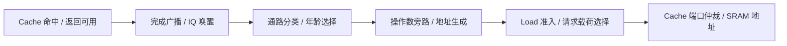

# V7 500 MHz 时序优化方案

本轮为分析与实施顺序设计，基于已提交的 V7 `690c35ba5f61a6015766e5db1c3a8893b611ebde`。已核对 RTL 与正式验收记录的摘要一致，并复用原综合网表、原 Liberty、原 STA 约束展开关键路径；尚未测量任何优化候选。分析数据与日志摘要见 [v7-500mhz-analysis.json](v7-500mhz-analysis.json)。

将“保证 IPC”按不低于当前 **1.1002013686** 规划，同时继续满足原门槛 > 1.0985；总面积含 SRAM ≤ **36,000 μm²**，课程 STA 估算频率目标 ≥ **500 MHz**。首轮候选以六项周期完全不退化为验收条件。

## 约束与难点

| 项目 | 当前 V7 | 新目标 / 可用空间 |
| --- | ---: | ---: |
| IPC 几何平均 | 1.1002013686 | 保持或提高 |
| 最小可行周期 | 3.1767578125 ns | ≤ 2 ns，需要缩短约 37.04% |
| 估算频率 | 314.786351 MHz | ≥ 500 MHz，提升约 58.84% |
| 总面积 | 30,717.501 μm² | 尚余 5,282.499 μm² |

原 IPC 门槛只允许约 0.1549% 的几何平均周期增长；首轮要求保持现有 IPC，因此增加 Load 命中延迟、关闭提前 Load 或普遍加深流水线都不适合作为起点。历史筛选中的 `execute-d32` 在引入选择拍 Load 前仅为 1.080607，这不是当前 V7 直接关闭某参数的实测值，但说明这条低延迟通路对 IPC 很重要。

所有候选沿用既有官方六项程序、`LATENCY=10`、退出排空条件、ABC `BUFx2_ASAP7_75t_R / 1 fF`、STA 输出 5 fF、I/O 各 0.2 ns、时钟不确定度/转换时间各 0.05 ns。500 MHz 必须由相同负载和 SRAM 模型下的最小可行周期确认。

## 已确认的瓶颈

对同一综合网表新增了三类报告：全设计前 200 条、触发器输入前 30 条、外部输出前 20 条路径。

| 路径组 | 观察 |
| --- | --- |
| 全设计前 200 条 | 全部从 `_326473_/QN` 出发，对应 D Cache `address[13]`；其中 96 条到 SRAM，104 条到触发器 |
| 最差 SRAM 路径 | 到 D Cache 数据 SRAM `addr_in[3]`；到达约 3.0765 ns，2 ns 时钟下裕量约 −1.1765 ns |
| 最差触发器路径 | 到达约 3.102 ns，裕量约 −1.147 ns；说明仅修 SRAM 末端驱动不足 |
| 外部输出 | 最差 `wdata[8]` 到达约 0.3446 ns，裕量约 +1.405 ns；不是首要矛盾 |

数据来源为 `build/v7-500-analysis/`。这里只统计报告列出的路径，不把前 200 条当成全设计全部路径。

相关 RTL 组合依赖为：

这是结合代码整理的依赖关系，不能把每段都当作已独立测量的延迟。网表已确认存在连续 **9 级 XOR/XNOR**，仅这段到达时间从约 0.929 ns 增到 1.210 ns。它与 RTL 中逐项累加 `older_integer_count` 的拓扑相符，归属仍需通过单项替换后的综合交叉确认。

此外有两个明显的重负载点：`address[13]` 的反相器负载约 **20.73 fF**、延迟约 **0.2697 ns**；末端地址门驱动四个字节 SRAM 引脚，负载 **20 fF**、延迟约 **0.2518 ns**。两者合计约 0.522 ns，小于所需缩短的 1.177 ns，即使理想消除它们，也不足以达到 500 MHz。必须同时缩短内部逻辑链。

## 优先实施措施

### 1. 将整数年龄计数改成平衡判定树

位置：[cpu_core.sv](../../verilog/cpu_core.sv) 的 `older_integer_count`、`integer_candidate` 和 `grant`。

当前为每个 IQ 项逐项累加更老的就绪整数数目，最后只判断是否等于 0 或 1。完整整数计数超出了实际需要。改为平衡树，只传递“全零”和“恰好一个”两种谓词：叶节点为 `zero = !candidate`、`one = candidate`；合并时 `zero = left.zero && right.zero`，`one = (left.one && right.zero) || (left.zero && right.one)`。12 项树的逻辑合并深度为 4 层，而非逐项进位。

保持原有全部选择规则：A 优先非整数，B 优先控制流；仅整数时两路分别取原来的第一/第二老项；年龄仍来自 IQ 年龄矩阵。位宽截窄或直接换成 `$countones` 不能保证获得平衡结构，需要检查映射结果。

**目的：** 同周期、同选择结果，缩短唤醒到选择的链；还有减少面积的可能，但增益必须实测。

### 2. 为提前 Load 分离地址准备与准入控制

位置：`selected_payload/selected_a`、`load_payload_early`、`load_address`、`load_request_bypass`、`d_req_addr`。

当前提前 Load 地址复用通用 A 路选择，其中包含整数填充与第二老整数判定；最终 `d_req_addr` 又受包含完整准入条件的 `load_request_bypass` 控制。这样，即便某些整数选择结果不会形成有效 Load，静态地址路径仍可能穿过这部分逻辑。

建议拆成两条并行路径：

- **载荷路径：** 从 A 路非整数候选的年龄选择准备 Load 操作数、立即数和地址；有旧 EX Load 时由它优先拥有载荷。访存队列有未发送项时优先使用该队列载荷，否则准备前端候选载荷。
- **授权路径：** 原有选择接受、自然对齐、RAM 范围、旧 Store 冲突、队列信用及恢复条件共同决定是否真正入队、握手和更新状态。

载荷可以在无效周期变化，实际请求仍必须先取得稳定事务身份。不能改变旧请求背压时的有效载荷，也不能把推测地址变成未授权写操作。重点复用现有 PRF 读口；若必须增加地址专用读取网络，单独测量面积成本。

**目的：** 从 SRAM 地址路径移除与有效 Load 载荷无关的整数排序、晚到有效条件和重复选择，保持请求接受周期不变。这是最值得与措施 1 组合验证的结构改动。

### 3. 缩短 D Cache 命中返回与地址驱动

位置：[dcache_writeback.sv](../../verilog/memory/dcache_writeback.sv) 的 `hits`、`hit_way`、`response_push_data`、`tag_addr` 和 `data_addr`。

- 命中数据选择考虑直接用各路命中位形成平衡掩码或树，减少“命中位→优先编码 hit_way→数据多路选择”的串行关系。保留唯一有效命中的不变量，并覆盖失效载荷扰动。
- 命中判定用的请求 tag 与标签 SRAM 写入载荷分离。后者只在合法接受请求时保存、供后续 INSTALL 使用，降低同一地址位同时驱动比较逻辑和四路 SRAM 数据引脚的负担。两份状态的更新语义必须明确，避免综合把无效的简单复制重新合并。
- 把填行写、Store hit 写、victim read 和普通预读的地址源按实际互斥关系组织为平衡选择，按路保持本地控制。只有实际映射后保留的扇出降低才算收益。

**目的：** 保留 32 KiB / 4 路 / 256 B 行、命中响应与连续 Store 时序，用逻辑组织和有限复制改善路径。缓存容量和行长先保持不变。

### 4. 最后收敛 AGU 和剩余重负载锥

现有 AGU 已是 16+16 位 carry-select。当前最差终点是 SRAM 低位地址，因此继续只优化高 16 位加法不一定有效；要检查低位索引、对齐/范围判断如何通过控制选择影响地址输出。

在前三项后的真实关键路径上，比较更小分组的 carry-select 或分层进位网络，并评估局部控制复制。面积空间优先用于确实处于关键锥的逻辑，不全面复制 PRF、AGU 或 Cache。首轮候选宜控制在约 34,000 μm² 以内，为最终收敛留出余量；这是预算分配，不是面积预测。

## 实验顺序与停止条件

1. **S1：仅替换整数年龄计数。** 对候选向量、年龄掩码证明判定等价；检查综合后 XOR/计数链和次差路径是否改变。
2. **S2：在 S1 上分离提前 Load 载荷。** 重点验证旧 EX 优先级、队列背压、同拍 Load+Store 入队、字节转发、恢复取消和晚到响应。
3. **S3：逐项加入 Cache 命中选择和本地地址控制。** 每个子项单独记录周期、面积和路径变化，防止多个变化掩盖收益来源。
4. **S4：针对剩余瓶颈优化 AGU/扇出。** 同时检查 SRAM 和触发器终点；每轮重新找关键路径。
5. 达到目标后，用冻结源码执行现有完整 Linux 入口，保留默认 189 项严格定向、五组共 945 项兼容回归、故障/单元/SAT 检查，再复测六项 IPC 和综合。

每个零周期候选先要求六项周期与当前 V7 一致或更少：**8624、16694、132395、121282、5317、4535**。任何周期变化都必须解释并重新计算精确几何平均。综合使用原流程，所有路径和时钟检查满足 ≤ 2 ns，且总面积 ≤ 36,000 μm²，才算 500 MHz 达标。

若这些重构仍不能达到 500 MHz，再单独评估可覆盖延迟的选择性流水化及 IPC 补偿。普遍增加 Load/分支一拍、缩小窗口或缓存会改变性能机制，应以新的实测候选评估，不能提前承诺保持 IPC。当前证据支持上述无新增流水拍数的优先顺序，尚不足以保证最终一定达到 500 MHz。
