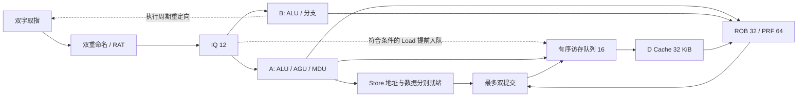

# V7 设计：两条可共享整数运算的执行通路与解耦访存

基线为 `a66193614d8ac59b606eb41d0ed973a0cbc3c7e2` 的 V6；测试子模块为 `29f980727f7d99a1842a58f34091c7579ba3fe85`。本文保留设计阶段的结构方案与实验原型结果；原型现已集成到生产目录 `verilog/`，正式验收见 [V7 实施记录](v7.md)。原型补丁、参数、源码摘要与测量索引分别见 [原型补丁](v7-prototype.patch)、[实验结果](v7-design-results.json)。

## 目标与测量口径

验收要求为 **IPC 几何平均 > 1.0985、课程 STA 估算频率 > 300 MHz、包含 SRAM 的总面积 ≤ 36,000 μm²**。

| 指标 | 当前 V6 | V7 设计原型 |
| --- | ---: | ---: |
| 六程序 IPC 几何平均 | 0.8676481522 | **1.1002013686** |
| 课程估算频率 | 608.437314 MHz | **314.786351 MHz** |
| 总面积，含 SRAM | 17,776.466 μm² | **30,717.501 μm²** |

IPC 使用原始六项程序、`LATENCY=10`、官方动态指令数和完整仿真周期；计入复位、填行、以及退出前脏行排空。没有改程序、指令数、外存延迟或退出条件。综合沿用项目 `BUFx2_ASAP7_75t_R / 1 fF` ABC 映射设置；OpenSTA 输出负载仍为 **5 fF**，目标 2 ns，I/O 延迟 0.2 ns，不改变库或 SRAM 模型。频率从最小可行周期计算，不以目标时钟代替实测结果。这是理想时钟、无布线寄生的课程估算。

V6 到门槛需要约 **26.61%** 的 IPC 提升，即几何平均周期下降约 **21.02%**。原型 IPC 高于门槛 **0.00170137，约 0.155%**；这是可行性证据，余量尚小。正式实现宜争取 1.12 以上，以容纳后续时序修正与验证所需的流水线调整。

最终原型的最小可行周期为 **3.176758 ns**，频率比 300 MHz 高约 **4.93%**，面积距上限还剩 **5,282.499 μm²（14.67%）**。逻辑面积为 18,905.769 μm²，SRAM 为 11,811.732 μm²。报告中的负裕量 −1.176495 ns 对应 2 ns 的 500 MHz 目标，不能据此误判 300 MHz 门槛，也不能宣称通过 500 MHz。

| 程序 | 动态指令数 | V6 周期 | 原型周期 | 原型 IPC |
| --- | ---: | ---: | ---: | ---: |
| median | 6,961 | 10,316 | 8,624 | 0.807166 |
| multiply | 21,722 | 18,405 | 16,694 | 1.301186 |
| qsort | 139,900 | 176,407 | 132,395 | 1.056686 |
| rsort | 195,719 | 175,109 | 121,282 | 1.613751 |
| towers | 5,278 | 6,465 | 5,317 | 0.992665 |
| vvadd | 4,524 | 6,111 | 4,535 | 0.997574 |

## 为什么这样分配面积

V6 的两个发射选择器按指令类型分工：简单整数占一路，分支、访存、乘除共用另一路。第二重命名和提交位置也只接受简单整数。六项性能程序中，median 的控制/访存比例分别约 36.5%/34.5%，qsort 为 30.7%/32.0%，towers 的访存比例约 60%。仅增加第二个整数运算机会不能消除这些竞争。

逐提交分析还确认，六个性能程序的硬件 M 扩展执行次数都是 **0**；`multiply` 使用软件乘法。优先加速硬件乘除器不能改善本次 IPC 指标。绝大多数已接受 Load 的 Cache 响应为 1 周期，许多等待发生在请求之前；增加多个 MSHR 也不是本轮第一优先级。

以下均为本次实际仿真结果。单项参数实验基于 V6；结构实验逐步组合，收益不能相加。早期结构原型只用于性能筛选，后来补齐的恢复与 Load 重试规则也是最终方案的必要部分。

| 实验 | IPC 几何平均 | 决策 |
| --- | ---: | --- |
| V6 原始配置 | 0.867648 | 基线 |
| 只开启恢复拍取指请求 | 0.888073 | 保留 |
| 只扩大 ROB/PRF/IQ 等窗口 | 0.879485 | 扩容配合结构改动使用 |
| 只将 D Cache 增至 32 KiB | 0.874848 | 收益集中于 rsort，后期再加入 |
| 只将 I Cache 增至 4 KiB | 0.867648 | 不加入 |
| D 行改为 128 B / 64 B | 0.853267 / 0.821323 | 保留 256 B 行 |
| BTB 128 项、局部历史 2 位 | 0.868377 | 保留 64 项、1 位局部历史 |
| 仅允许两条整数同时执行 | 0.877898 | 必须同时处理分支/访存竞争 |
| 扩宽重命名/提交、分离分支通路、扩大窗口 | 0.961400 | 后端基础结构 |
| 再分离 Store 地址与数据 | 1.055005 | 本轮主要收益来源 |
| 再允许第二提交位置退休 RAM Store，D Cache 32 KiB | 1.069846 | 保留 |
| 再将重定向前移到分支执行周期 | 1.080607 | 保留并检查时序 |
| 对普通结果做完成到提交直通 | 1.077755 | 略有退化，不加入 |
| 就绪 Load 前移，补齐重试并分离数据/有效控制 | **1.100201** | 最终设计原型 |

大窗口下将 IQ 从 12 增至 16，或进一步增大 ROB，收益很小。因此先保留下面的配置，面积预算用于访存路径与时序收敛。未选择更大的 I Cache、流水乘法器、RAS、多 MSHR 或推测越过未知 Store 地址。

## 建议结构与默认参数

| 部件 | V7 起点 |
| --- | --- |
| 取指 / 重命名 / 选择 / 提交宽度 | 2 / 2 / 2 / 2 |
| ROB / PRF / IQ | 32 / 64 / 12 |
| LSQ / 持久访存描述符队列 | 16 / 16 |
| 分支检查点 | 8 |
| 取指 FIFO / 在途请求 | 16 个指令字 / 4 笔 |
| I Cache | 2 KiB，直接映射，128 B 行，64 位同步 SRAM 取指 |
| D Cache | 32 KiB，4 路，256 B 行，写回/写分配 |
| 预测器 | 64 项 BTB，XOR 索引，bimodal/local1 混合，提交训练，RAS 关闭 |
| 通路 A | ALU、Load/Store 地址生成、迭代 MDU |
| 通路 B | ALU、条件分支、JAL/JALR |
| 完成资源 | A、B 各一路，Load/MDU 共享一路 |



### 1. 让两条通路覆盖实际指令组合

A 优先服务就绪访存/MDU，B 优先服务就绪分支。空闲通路补入整数运算；只有整数就绪时，分别取最老和次老项。这样支持 ALU+ALU、ALU+Load/Store、ALU+Branch、Load/Store+Branch。仍只有一个访存请求入口、一个 MDU 和一个分支执行入口。选择保持两条，复用现有四个 PRF 读口和最多三个完成口。

第二重命名位置可接受 Load、Store、MDU 和控制流。同组两条访存时，LSQ 信用计数增加 2，第二条 Load 的 older-store 掩码包含同组第一条 Store；同组 RAW/WAW 继续走重命名旁路。每拍最多分配一个控制流检查点：控制流在第二位置时，检查点包含第一条映射及第二条自身 link 映射；在第一位置时排除第二条年轻映射。

第二提交位置可退休已完成的 Load、MDU、控制流或 RAM Store，每拍仍最多一个 Store 入队、一个控制流更新预测器。第二 Store 使用自己的 ROB 身份、地址、数据、掩码和诊断 PC。MMIO 保持 ROB 头串行化；错误或未恢复的重定向阻止越过它提交。

### 2. Store 地址先算，数据后到

Store 的基址就绪即可占用 AGU，记录地址、写掩码、数据源物理寄存器和字节偏移。数据未就绪时，监听完成广播并保存数据；地址与数据都有效后才允许退休。

Load 仍等待所有更老 Store 的地址明确。非别名 Load 可以越过地址已知但数据未到的 Store；同字冲突则等待数据，现有逐字节最年轻旧 Store 转发继续生效。原型对同字不同字节也保守等待，未引入未知地址推测或违例回放。

**等待必须可重试。** 一个同地址 Load 不能一直占着 EX，挡住尚未发射的旧 Store 数据生产者。Load 在真正进入访存队列前保留 IQ 项；EX 阻塞时释放执行通路并重新选择，进入 EX 的同一 Load 暂时从候选集合排除，避免重复执行。别名双 DIV 定向程序在修复前于三种延迟下均超时，修复后全部通过；非别名对照也通过。用例生成器为 [v7_design_probes.py](../../verification/directed/v7_design_probes.py)。

### 3. 缩短 Load 请求与分支恢复路径

已就绪、合法、自然对齐的 RAM Load，在不存在旧 Store 数据冲突、访存队列有空间且没有旧 EX Load 争用时，可在选择周期直接预约持久描述符并发起 Cache 请求。其余情况保留普通 EX 路径或重试。每个请求先拥有稳定身份，再接受响应；分支取消后仍按原身份排空。没有提前承诺未完成填行的结果，末拍总线错误的合并规则保持不变。

提前 Load 复用 A 的操作数读取，可能使选择与执行事件处于不同流水级。每周期仍最多选择两条指令；某周期的 `CPU_TRACE ISSUE` 执行接受事件可能达到三条。正式验证应增加选择事件来验证选择宽度，不能据执行事件误称三发射，也不能删除宽度检查。

分支执行周期直接通知前端重取，ROB/RAT 恢复仍在下一周期完成。标记前端已经处理该重定向，避免恢复拍再次取消新路径请求。B 通路可以在 A 阻塞时解析分支，所以恢复必须保留更老的 EX 操作数和身份；原 V6 无条件清空 EX 的做法不再适用。

### 4. 用数据准备与有效控制分离收敛时序

提前 Load 将选择、旁路、AGU 与入队放在同一周期，不能把完整的恢复/对齐/冲突检查结果再串到所有地址和元数据多路选择器之前。原型先依据端口归属准备 Load 载荷，再由 `early_load` 授权实际入队和 Cache 握手。旧 EX Load 永远优先拥有这组载荷，只有真正接受时才更新有效状态。

仅做上述载荷分离时，频率为 299.240210 MHz，仍未达标。最终对提前 Load 的地址加法采用 **16+16 位 carry-select**：低半部计算进位，高半部分别预计算进位为 0/1 的结果，再选择输出；不增加流水级。Yosys SAT 对所有两组 32 位输入证明该实现与原 32 位模加法等价，六个性能程序的周期保持一致。

时序收敛过程如下；所有行均使用相同的课程约束，只有最后一行是交付补丁对应的最终原型。

| 版本 | 变化 | 估算频率 MHz | 总面积 μm² |
| --- | --- | ---: | ---: |
| R1 | 提前 Load，尚缺完整重试规则 | 288.694672 | 30,741.893 |
| R2 | 补齐 Load 重试与前进性 | 292.320868 | 30,725.432 |
| R3 | Load 载荷准备与有效控制分离 | 299.240210 | 30,744.314 |
| **R4** | **地址加法 carry-select，最终原型** | **314.786351** | **30,717.501** |

## 验证状态与正式 V7 实施顺序

最终 R4 原型已通过以下验证，详细来源和 SHA-256 摘要见结果 JSON：

| 检查 | 结果与范围 |
| --- | --- |
| 官方正确性，关闭 trace | **19/19**；最终 R4 源码，所有周期与 R2/R3 一致 |
| 官方性能，关闭 trace | **6/6**；六项周期与下述逐提交运行一致 |
| 六项性能程序逐提交核对 | 6/6，通过独立 RV32 参考模型比较 374,104 条提交；周期与 R2/R3 一致 |
| 故障注入 | 27/27，外存延迟 1/10/31 |
| Store 数据晚到与 Load 前进性 | 18/18，字/字节/半字的别名和非别名用例 × 延迟 1/10/31，共比较 486 条提交 |
| 地址加法等价 | SAT 证明两组任意 32 位输入均等价 |
| 课程综合与 STA | 频率、面积门槛均满足；采用上表固定 R4 源码 |
| 补丁复现 | 在独立 V6 副本应用补丁，所有生成源文件与 R4 快照逐字节一致 |

完整逐提交正确性回归在 R2 上通过 **19/19，共 6,929,385 条提交**。R3 和最终 R4 均通过关闭 trace 的官方 19 项正确性测试，所有周期与 R2 一致。R4 的最后一步仅替换为已证明等价的地址加法；上述逐提交完整回归的来源明确保留为 R2，不将其记成 R4 的同源运行。仿真使用 macOS 原生 Verilator 5.052 和未修改的官方 C++ harness，综合使用课程 Linux Yosys 0.63 / OpenSTA 3.1.0。

这份原型不是 V7 发布验收。实施时按以下顺序收敛：

1. 集成补丁，先锁定本表参数和同源性能/综合复现；保持 V6 可比较基线。
2. 为选择、Store 地址完成、Store 数据捕获和 Load 重试补充独立事件及检查器。覆盖同组两条访存、第二位置控制流、第二位置 Store 提交、字节重叠转发、旧 EX 跨恢复、晚到结果与物理寄存器复用。
3. 建立 V7 严格定向配置，在延迟 1/10/31 下证明每个覆盖条件确实发生；原 V6 的 156 项时序覆盖不能直接作为 V7 通过证明。同步核验小容量非二次幂、单宽、写回故障、Cache/AXI 背压和无效载荷扰动。
4. 用正式 Linux 官方构建复核全部正确性与六项周期；固定源码后再运行课程综合。建议收敛预算为频率至少 350 MHz、面积不超过 34,000 μm²，IPC 尽量提升至 1.12；这些是工程余量目标，不是当前已测值。

## 复现实验原型

从上述 V6 基线创建独立源码副本，再应用补丁；不会覆盖生产 RTL：

```sh
mkdir -p build/v7-reproduce
git archive a66193614d8ac59b606eb41d0ed973a0cbc3c7e2 verilog | tar -x -C build/v7-reproduce
patch -p1 -d build/v7-reproduce < docs/experiments/v7-prototype.patch
python3 verification/runners/build_trace.py \
  --filelist build/v7-reproduce/verilog/filelist.f --out build/v7-reproduce/trace
python3 verification/runners/run_cpu.py --sim build/v7-reproduce/trace/sim \
  --cases testcases --case 'perf_*' --latencies 10 --out build/v7-reproduce/perf
python3 verification/directed/v7_design_probes.py --out build/v7-reproduce/probes
python3 verification/runners/run_cpu.py --sim build/v7-reproduce/trace/sim \
  --cases build/v7-reproduce/probes --latencies 1,10,31 --max-cycles 5000
python3 verification/runners/run_faults.py --sim build/v7-reproduce/trace/sim --latencies 1,10,31
python3 verification/runners/build_trace.py \
  --filelist build/v7-reproduce/verilog/filelist.f --out build/v7-reproduce/official --param TRACE=0
python3 scripts/testcase.py --kind correctness --build build/v7-reproduce/official \
  --testcases testcases --max-cycles 100000000 --latency 10 --sim build/v7-reproduce/official/sim
python3 scripts/testcase.py --kind perf --build build/v7-reproduce/official \
  --testcases testcases --max-cycles 1000000 --latency 10 --sim build/v7-reproduce/official/sim
tools/dev linux synth FILELIST=build/v7-reproduce/verilog/filelist.f \
  SYNTH_OUT=build/v7-reproduce/synth MODE=opt
```

地址加法的组合等价证明源文件为 [v7_address_equivalence.sv](../../verification/formal/v7_address_equivalence.sv)，与本次 SAT 输入逐字节相同。在含 Yosys 的课程环境中运行：

```sh
yosys -p 'read_verilog verification/formal/v7_address_equivalence.sv; prep -top address_equivalence; sat -verify -prove ok 1 -show-inputs'
```

完整参数筛选及每个实验的来源摘要保存在结果 JSON 中。所有较早原型的收益都只是该版本的实测筛选结果，不能替代最终候选的正确性、时序与面积验收。
